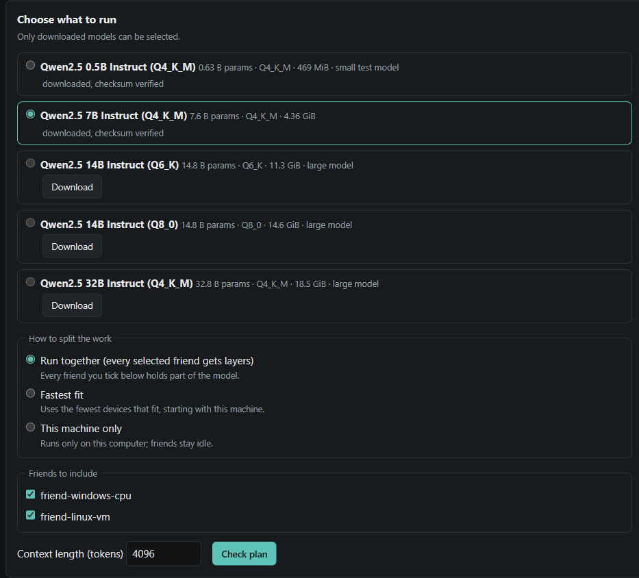
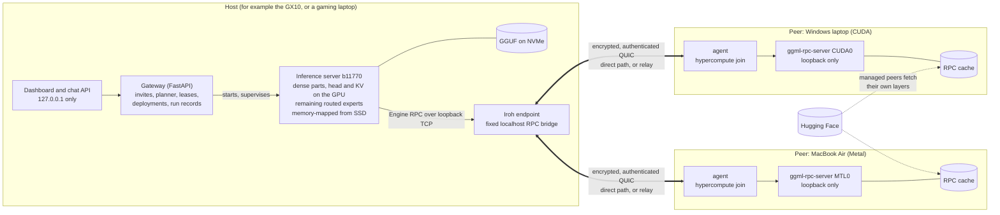
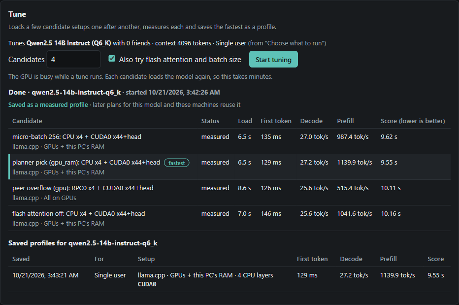
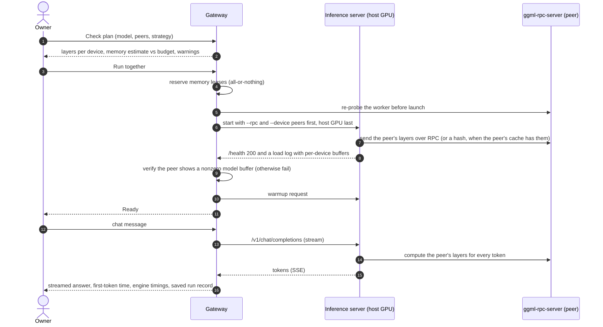
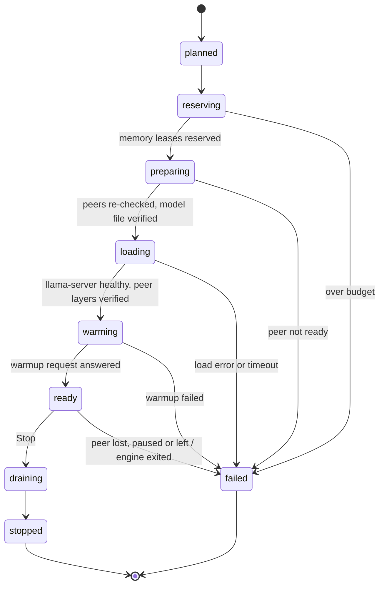
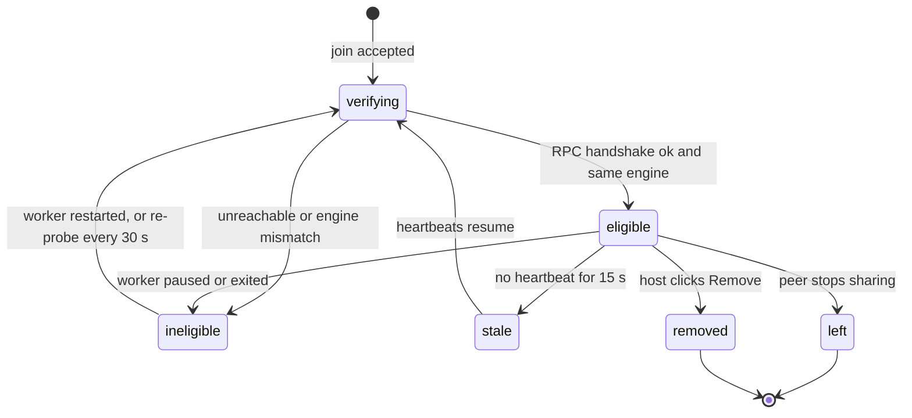
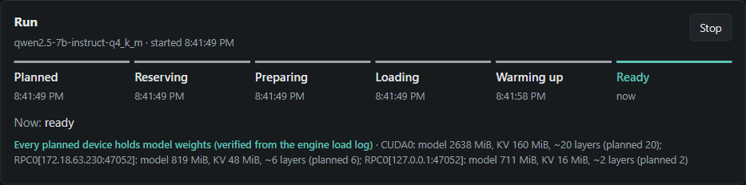
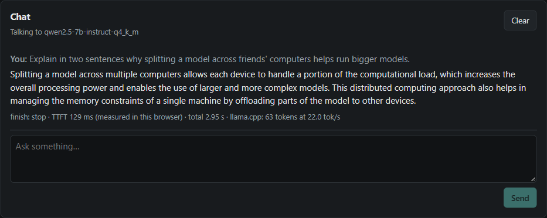
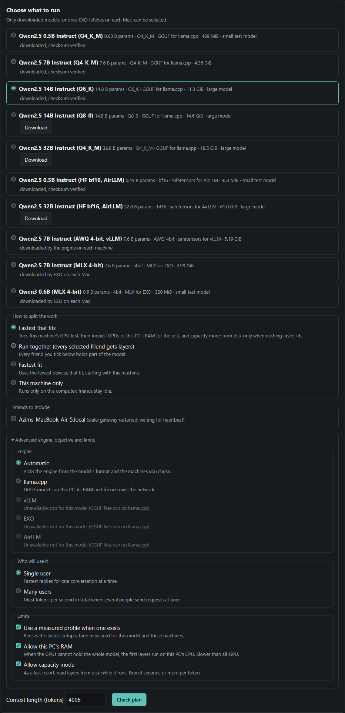
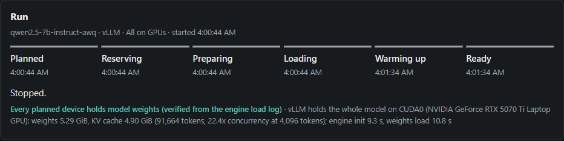

# Hypercompute

Hypercompute pools a few friends' computers (Windows and Linux NVIDIA machines, Apple Silicon Macs) into one
model deployment over an encrypted Iroh QUIC tunnel, so the group can run an open model bigger than any one
of them holds. One person hosts the gateway, dashboard and planner; everyone else joins with a one-click script and
lends part of their memory while they share.



> **Status, 2026-10-25.** Working prototype, measured on real machines: a Windows gaming laptop, MacBook Airs and an
> ASUS Ascent GX10 (Linux, GB10). Pooling sped up models too big for the laptop, and slowed decode on the GX10 and on
> a model that fits the laptop. Both sides are below with their conditions. Method and every run: [the paper runs](docs/research/PAPER-RUNS-2026-10-22.md).

## Contents

1. [Measured results](#measured-results)
2. [Quickstart](#quickstart)
3. [SDK](#sdk)
4. [Benchmarks](#benchmarks)
5. [Sponsor integrations](#sponsor-integrations)
6. [Status and limits](#status-and-limits)
7. [How it works](#how-it-works)
8. [Engines and tiers](#engines-and-tiers)
9. [Setup on any machine](#setup-on-any-machine)
10. [What happens under the hood](#what-happens-under-the-hood)
11. [Dashboard tour](#dashboard-tour)
12. [Command reference](#command-reference)
13. [Troubleshooting](#troubleshooting)
14. [Security model](#security-model)
15. [Repository layout](#repository-layout)
16. [Development](#development)
17. [More documentation](#more-documentation)

---

## Measured results

Every number in this section comes from [docs/pitch/NUMBERS.md](docs/pitch/NUMBERS.md), which reads the run records
indexed under `results/capacity/`. A ratio is pooled over alone with a 95% bootstrap interval. Samples are small:
most rows are one pooled run against one alone run, so an interval shows the spread inside one load, not between
loads.

### Laptops: one gaming laptop plus two MacBook Airs

Conditions: host ROG Zephyrus G14 (RTX 5070 Ti Laptop GPU, 12 GB VRAM, 31.1 GiB RAM, Windows 11). Peers: two M4
MacBook Airs with 16 GiB each, at most 10.5 GiB lent by each. Home network, both Macs direct over Iroh, round trip 5
to 8 ms before each pooled run and up to 46 ms after. One pooled run per model (paper run R7).

| Model | Prompt / answer, reps | Alone | Pooled | Pooled / alone [95% CI] |
|---|---|---|---|---|
| Llama 3.3 70B Instruct (Q4_K_M, dense, about 40 GiB), decode | 64 / 32, 2 vs 2 | 0.165 tok/s | 0.898 tok/s | 5.44x [5.42, 5.47] |
| gpt-oss-120b (MXFP4, 59.03 GiB MoE), decode | 128 / 64, 3 vs 3 | 3.829 tok/s | 8.740 tok/s | 2.28x [2.00, 2.54] |
| gpt-oss-120b, first token | same | 34.22 s | 4.83 s | 7.08x sooner [6.20, 8.23] |
| gpt-oss-120b, 8 chats at once, total decode | 128 / 64, 3 batches per side | 12.19 tok/s | 16.44 tok/s | 1.34x [1.24, 1.48] |

- **70B.** Alone, the laptop rereads 23454 MiB (22.9 GiB) from its SSD for every token. Pooled is still under one
  token a second: the 32-token answer took 39.53 s against 197.9 s alone. This is one pair of runs and likely the
  high end. A second alone run, stopped by a memory guard, decoded about 9% faster in its warmups, and against that
  the pool would be 4.99x. Read it as about 5 times.
- **120B first token.** An earlier session on building Wi-Fi with three Macs (9 vs 9 reps, paper run R2) gave the first
  token 2.69x sooner [2.35, 3.08] and decode 1.27x [1.10, 1.47]. The two sessions differ in network and number of
  Macs, so they cannot say which one matters.
- **8 chats at once.** Each chat got about 2.05 tok/s, slower than one chat on the laptop alone (3.83). The pool's
  lead shrinks as chats are added: 2.28x at 1, 1.46x at 4, 1.34x at 8. Every chat was served by inference-server
  slots with one shared KV cache (`-np N -kvu`, paper run R7.5).

### One big host: ASUS Ascent GX10

The GX10 (NVIDIA GB10, 121.6 GiB unified memory) holds gpt-oss-120b entirely on its GPU. **Alone, with no peers**,
it decoded at 56.00 tok/s (mean of 9 reps, 128 / 64, while a model download ran on the box, paper run R6). That is a
different host, not pooling. If one machine holds your model, run it there.

For the two biggest models, the pool was the GX10 plus the gaming laptop (CUDA, at most 9 GiB lent) and three M4
MacBook Airs (7.5 to 11.5 GiB each), on home Wi-Fi, 64 / 32, 4 vs 4 reps from 2 runs per side (paper run R6):

| Model | Prompt reading, pooled / alone | First token | Decode alone | Decode pooled | Decode, pooled / alone |
|---|---|---|---|---|---|
| DeepSeek-V3.1 671B (UD-TQ1_0, 158.8 GiB) | 2.41x [2.19, 2.73] | 2.38x sooner [2.15, 2.69], 24.67 s to 10.37 s | 1.805 tok/s | 1.497 tok/s | 0.83x [0.76, 0.91] |
| Kimi-K2.6 1T (IQ1_S, 193.16 GiB) | 1.50x [1.41, 1.59] | 1.48x sooner [1.37, 1.60], 28.2 s to about 19.1 s | 1.799 tok/s | 1.540 tok/s | 0.85x [0.81, 0.89] |

In the 671B pooled runs one Mac stayed on the Iroh relay (48 to 103 ms) and the pooled reps mix two layouts. In the
1T pooled runs all four peers were direct (5 to 55 ms). Both models also run on the GX10 alone, and the 671B also
ran on the gaming laptop alone at 0.481 tok/s (64 / 32, 2 reps, paper run R4). The laptops-only pool never ran the
671B or the 1T.

### Every machine at once: the GX10 host with the gaming laptop and two MacBook Airs

The GX10 hosted, with the gaming laptop (CUDA, at most 9 GiB lent) and two M4 MacBook Airs (at most 11.5 GiB each)
as peers, all direct over Iroh on the home network (5 to 16 ms before each pooled run, up to 52 ms after). One run
per side (paper run R8):

| Model | Prompt / answer | GX10 alone | Every machine | Pooled / alone [95% CI] |
|---|---|---|---|---|
| Llama 4 Maverick 400B (UD-Q2_K_XL, 142.17 GiB, 17B active), decode | 128 / 64, 3 vs 3 | 9.79 tok/s | 4.27 tok/s | 0.43x [0.40, 0.48] |
| Llama 4 Maverick 400B, 8 chats at once, total decode | 128 / 64, 3 batches | 43.36 tok/s | 15.07 tok/s | 0.34x [0.32, 0.37] |
| Kimi-K2.6 1T (IQ1_S, 193.16 GiB), decode | 64 / 32, 2 vs 2 | 1.779 tok/s | 1.774 tok/s | 0.99x [0.96, 1.03] |
| Kimi-K2.6 1T, first token | same | 27.0 s | 20.2 s | 0.75x [0.72, 0.78] |
| DeepSeek-V3.1 671B (UD-TQ1_0, 158.8 GiB), decode | 64 / 32, 4 vs 4, interleaved | 1.761 tok/s | 1.771 tok/s | 1.00x [0.92, 1.09] |
| DeepSeek-V3.1 671B, first token | same | 25.0 s | 15.8 s | 0.63x [0.57, 0.69] |

- **400B on one box.** Maverick is larger than the GX10's memory, yet alone it read only 53 MiB per token from SSD
  and decoded near 10 tok/s; adding the laptops made every speed metric slower. Run it on the GX10 alone.
- **1T across every machine.** With every peer direct, the 1T decodes at parity pooled and answers 15% sooner (44.4 s
  to 37.7 s for 32 tokens), because prompt reading is 1.43x faster and half the SSD reads go away. The alone runs were about 4 hours earlier
  in another gateway session, not interleaved, which may inflate the first-token gain.
- **671B across every machine.** Run with the bench kit as alone, pooled, alone, pooled in one session (Macs at 10
  GiB): decode at parity, the first token 1.58x sooner, the 32-token answer 21% sooner (42.6 s to 33.4 s), and SSD
  reads down to 37%. An earlier comparison across separate sessions overstated the decode gain; the
  interleaved runs supersede it. With one Mac on the relay, R6 measured 0.83x.

### The honest cost

- **On a big host it depends on the model and the network.** In R6 the GX10 pool decoded at 0.83x on the 671B
  and 0.85x on the 1T. One of the four peers used the relay in the 671B runs; all four were direct in the 1T runs. With three direct peers it was even on the 671B (interleaved) and
  the 1T, but 0.43x on Maverick 400B, which nearly fits the GX10 and barely reads its SSD. At one chat, each peer is one
  blocking network round trip per token, so pooling pays off only when the SSD reads it saves cost more than that.
- **Decode is slower pooled on a model that fits one machine.** Qwen3-Next-80B-A3B (Q3_K_M, MoE) fits the gaming
  laptop: 21.373 tok/s alone against 10.005 pooled, 0.46x [0.36, 0.62], and the first token came later (1.55 s
  against 4.32 s). Same laptop pool as above, 128 / 64, 6 alone reps from 2 runs against 3 pooled reps from 1 run
  (paper run R7.1).
- **A cold pooled start is slow.** Each pooled run first seeds its peers, so a cold start took about 15 to 16
  minutes on the laptops (873 to 948 s) and 17 to 32 minutes on the GX10 (1043 to 1919 s), against 34 to 42 s alone
  on the laptops and 239 to 266 s alone on the GX10.

Where pooling helped, the host alone was paging the model from its SSD. More cases where it did not help are in
section 2 of [NUMBERS.md](docs/pitch/NUMBERS.md).

---

## Quickstart

### Host (once)

```bash
git clone <repository URL> hypercompute     # the repository is private: you need collaborator access
cd hypercompute
uv sync
uv run hypercompute engine install --yes    # pinned engine for this OS and GPU, SHA-256 verified
npm --prefix frontend ci && npm --prefix frontend run build   # the dashboard, built once on the host
uv run hypercompute models pull qwen2.5-0.5b-instruct-q4_k_m  # small model for the first check
```

### Host (every time): one command

| macOS | Windows | Linux |
|---|---|---|
| double-click `join/hypercompute-host.command` | double-click `join\hypercompute-host.cmd` | `./join/hypercompute-host.sh` |

It checks the engine, starts `hypercompute host --transport iroh --port 8001` in the background, opens the dashboard
at `http://127.0.0.1:8001/` and puts a first invite on the clipboard. For each further friend, open
`hypercompute-invite` the same way. An invite works once, for 15 minutes. Send it in a private message.

### Demo app

After `uv sync`, double-click `join/hypercompute-app.command` on a Mac or `join/hypercompute-app.cmd` on
Windows. On Linux, run `./join/hypercompute-app.sh`. The local app shows peers, layer placement and chat in one
page. Each launch opens a browser link carrying a private session key. Keep that link and the invite off screen
when recording. The app defaults to port 8790 and connects to the gateway on port 8001.

### Friends: the one-click scripts in `join/`

1. Get the Hypercompute folder from the host and install [uv](https://docs.astral.sh/uv/getting-started/installation/)
   once. The folder holds programs that run as you, so take it only from a host you trust.
2. Open `join/hypercompute-join.command` (Mac), `join\hypercompute-join.cmd` (Windows) or run
   `./join/hypercompute-join.sh` (Linux) with nothing after it.
3. Paste the invite when it asks, check the memory it will lend, and type `y`. To stop, open `hypercompute-leave`.

The first run asks before it downloads Python packages and the inference engine. The full guide, including what
sharing does on your computer and a troubleshooting table, is [join/README.md](join/README.md).

### The same with the CLI

```bash
uv run hypercompute host --transport iroh --port 8001                     # host
uv run hypercompute invite --port 8001                                    # host: one join command per friend
uv run hypercompute join --ticket '<HOST-TICKET>' --code '<XXXXX-XXXXX>' --cache   # friend
```

The CLI's own default port is 8000. The scripts, the SDK and the benchmark driver use 8001.

### Run a model

Wait for each friend's card to show **Ready to contribute**. Pick the model, tick the friends, **Check plan**, then
**Run together**, and chat when the stepper reaches **Ready**. Or use the SDK below.

---

## SDK

`sdk/python` is a small client for the gateway (`hypercompute-sdk`, depends on `httpx` only). Install it with
`uv pip install ./sdk/python`, then on the host:

```python
from hypercompute_sdk import Pool

with Pool() as pool:  # http://127.0.0.1:8001; owner calls answer only on the host itself
    dep = pool.deploy_model("qwen2.5-0.5b-instruct-q4_k_m", strategy="auto")
    print(pool.chat([{"role": "user", "content": "Say hello."}], max_tokens=32)["choices"][0]["message"]["content"])
    pool.stop(dep["id"])
```

The SDK fetches the owner token from `GET /api/owner/bootstrap` and sends it as `X-Hypercompute-Owner`. Reads need
no token, writes do, and both answer only on loopback. The gateway also speaks the OpenAI API on the host:
`GET /v1/models` and `POST /v1/chat/completions` (with the owner header). Methods, streaming and errors:
[sdk/python/README.md](sdk/python/README.md). Gateway API: [docs/API.md](docs/API.md).

---

## Benchmarks

| Where | What |
|---|---|
| [bench/RESULTS.md](bench/RESULTS.md) | Every pair and every run, generated from the run indexes by `uv run --no-sync python bench/hcbench.py report`, with each value checked against NUMBERS.md |
| [docs/pitch/NUMBERS.md](docs/pitch/NUMBERS.md) | The sheet to quote from: conditions, intervals, caveats and rounding rules |
| [docs/research/PAPER-RUNS-2026-10-22.md](docs/research/PAPER-RUNS-2026-10-22.md) | The paper: setup, method and confounds for runs R1 to R8 |
| [bench/README.md](bench/README.md) | How to plan and run a new benchmark with `bench/hcbench.py` |

Method in short: temperature 0, seed 7, `ignore_eos`, no prompt cache, fixed-length prompts. Decode is the engine's
own timing, (predicted_n - 1) / predicted_ms, over measured reps only. Ratios are a ratio of means with a percentile
bootstrap (10,000 resamples, seed 7). Every run goes through the gateway's own HTTP API, so it uses the same planner
and deployment path as the dashboard.

---

## Sponsor integrations

| Folder | Sponsor | What it does |
|---|---|---|
| [integrations/convex-room](integrations/convex-room/README.md) | Convex | A live room: anyone with the link sees who is in the pool and which machine holds which layers, and can send the pool a prompt without the owner token |
| [integrations/droid-autotune](integrations/droid-autotune/README.md) | Factory | When a machine joins or leaves, a Droid session proposes layouts, the planner checks each one, and nothing changes until the owner approves |
| [integrations/fetch-agent](integrations/fetch-agent/README.md) | Fetch.ai | An agent reachable from ASI:One chat that picks the biggest model the pool holds, shows the plan, runs the prompt and says who served it |
| [integrations/x402-proxy](integrations/x402-proxy/README.md) | Coinbase | An x402 paywall in test USDC on Base Sepolia that splits each payment across machines by the layers they served |

---

## Status and limits

| Area | State |
|---|---|
| Join, invites, heartbeats, layer split, dashboard, failure handling | Done |
| Iroh transport: encrypted QUIC, direct through NAT or through a relay | Done, used in every pooled paper run |
| MoE placement: whole layers to peers, routed experts file-backed on the host SSD | Done, measured on 120B, 235B, 671B and 1T models |
| Peers that download their own layers from Hugging Face (`--managed`) | Done, used in the pooled runs |
| One pool of Windows CUDA, Linux GB10 and macOS Metal machines | Done, measured (paper run R6) |
| One-click scripts, SDK and benchmark CLI | Used on the GX10, Windows laptop and two MacBooks; see [the end-to-end check](docs/E2E-CHECK-2026-10-25.md) |
| Laptop comparisons | 70B, 72B, 80B and 120B measured; other rows remain unmeasured |
| Many chats at once with a pooled GX10 | Maverick at 4 and 8 chats, Kimi at 8 chats measured in R8; see NUMBERS section 3e |

Limits worth knowing before you plan a session:

- **Only short prompts were measured** (64 and 128 tokens requested). Longer prompts may change every ratio above.
- **Output quality was not benchmarked.** The 671B and 1T runs use 1-bit quantizations and the 235B a 2-bit one.
  The 1T was spot-checked once (a correct iterative Fibonacci function at temperature 0).
- **The planner's speed estimates come from the laptop.** On the GX10 it ranked the 671B pool about 1.77x ahead;
  measured, it decoded at 0.83x. On a 121.33 GiB dense model, about the size of the GX10's whole memory, it
  approved a plan its own optimizer had found infeasible. The load failed and the box stopped answering SSH for
  about 50 minutes; another service on the rented box may have held memory (paper run R6.x).
- **Wi-Fi that isolates clients forces the relay.** On apartment guest Wi-Fi with the Macs on a phone hotspot,
  uploads to a Mac ran at about 1 MiB/s, round trips rose to 60 to 580 ms and a peer dropped mid-load (paper run R5,
  from the paper text). Use a router you control.
- **Losing a peer mid-run fails that run.** There is no live migration. A Mac that sleeps fails the deployment.
- **The repository is private and has no license yet.**

---

## How it works

There are two kinds of traffic. The **control plane** (Hypercompute's own API) handles invites, joining, heartbeats,
plans and seeding. The **data plane** is the inference engine's RPC protocol: the host's `llama-server` places each peer's
layers on that peer's `ggml-rpc-server` and asks it to compute them for every token. In Iroh mode both travel over
the peer's Iroh connection.



Key ideas:

* **One owner per model.** The host runs the only `llama-server` and holds the GGUF file. A peer holds its layers in
  the engine's RPC cache, either received from the host or, for a managed peer, downloaded by the peer itself from
  Hugging Face with ranged reads of exactly the tensors the plan gives it.
* **Whole layers to peers, experts to SSD.** For a mixture-of-experts model larger than the host's GPU (tier
  `moe_offload`), peers take whole layers sized by each peer's budget. The host GPU keeps every other layer's
  attention, router, shared experts, the output head and the KV cache. The routed experts that are left stay
  memory-mapped from the host's NVMe. Peers come first in `--device` and the host GPU last, so the vocabulary-sized
  logits never cross the network.
* **Prefill scales, decode pays per hop.** A prompt is processed in batches, so each peer runs its layers for many
  tokens at once. At decode, each peer is one blocking network round trip per token, in sequence.
* **Peers are verified before use.** A peer becomes usable only after the host completes a real engine RPC
  handshake with its worker. A run counts as pooled only after the engine's own load log shows the peer received
  layers.
* **Iroh transport.** Peers dial the host's Iroh endpoint with a ticket. Iroh holds a direct path through NAT when it
  can and falls back to a relay when it cannot. Workers stay on loopback. No VPN account is needed. LAN mode is still
  the CLI default; see [LAN mode](#lan-mode-trusted-network-only).

---

## Engines and tiers

One model runs on exactly one engine at a time. **Fastest that fits** (strategy `auto`) uses the fastest tier that
holds the model, so slow tiers are used only when nothing faster fits.

| Tier | What it does |
|---|---|
| `gpu` | Every layer on a GPU, this machine first, then peers |
| `gpu_ram` | The first layers run on the host CPU from RAM |
| `gpu_disk` | Like `gpu_ram`, but the CPU part is paged from the GGUF on disk (slow) |
| `moe_offload` | A mixture-of-experts model with every layer on accelerators except some routed experts, read from the file cache or the SSD only when a token routes to them |
| `stream` | The CPU part is read from the SSD every pass into fixed slot buffers (bounded memory) |
| `disk` | An optional engine reads every layer from disk for every token (capacity mode, very slow) |

The standard GGUF runtime supports Windows, Linux and macOS, including mixed NVIDIA and Apple Silicon pools.
Every pooled result above used this runtime. Optional adapters support single-GPU serving, full-precision disk
streaming and Apple-only clusters. Their compatibility limits and upstream licenses are documented in
[ENGINE_TIERS.md](docs/ENGINE_TIERS.md) and [ATTRIBUTION.md](docs/ATTRIBUTION.md).

Layer split rules in short ([split_optimization.md](docs/research/split_optimization.md)):

* **The host GPU goes last in `--device`.** The engine puts the output head on the last device, so the logits never
  cross the network; only small activations do.
* **For one user, fill this machine's GPU first** and send only the overflow away. Each layer on a slower device or
  behind a network hop adds latency, so splitting a model that already fits only makes it slower.
* **Overflow goes to the cheaper place**: a peer's GPU (one network round trip per token) or this machine's RAM. The
  planner estimates both, and `hypercompute tune` measures them and saves the fastest as a measured profile.



Full contract and per-engine details: [docs/ENGINE_TIERS.md](docs/ENGINE_TIERS.md). Research behind each engine:
[docs/research/](docs/research/). Image input for vision-language models (projector on the host, layers on the
pool): [docs/VISION.md](docs/VISION.md).

---

## Setup on any machine

| OS | Install once | Engine variant chosen automatically |
| --- | --- | --- |
| macOS (Apple Silicon) | `xcode-select --install`, then uv from its [install page](https://docs.astral.sh/uv/getting-started/installation/) | `macos-arm64` (Metal) |
| Windows 10/11 x64 | `winget install --id Git.Git -e` and `winget install --id astral-sh.uv -e` | `windows-x64-cuda13.4` with an NVIDIA driver R580+, otherwise a labeled CPU fallback |
| Linux x64 / arm64 | uv from its install page | `linux-x64-cuda13.4`, `linux-x64-cuda12.8` or CPU. On the GX10 (GB10) the measured runs used b11770 built from source with `scripts/build_llama_linux.sh --cuda-arch 121`, selected with `HYPERCOMPUTE_LLAMA_BIN_DIR` |
| Host only | Node.js 18+ (to build the dashboard once) | |

```bash
uv run hypercompute engine install --yes     # pinned engine for this OS/GPU, SHA-256 verified
uv run hypercompute doctor                   # engine smoke test, addresses, ports, firewall profile
```

`uv` installs its own Python 3.12; nothing touches the system Python. No compiler, CUDA toolkit or WSL is needed for
the release builds. Every machine in a pool must run the same engine release (b11770, RPC protocol 8.0.0). The
binaries are sha256-pinned in [configs/engines.lock.json](configs/engines.lock.json), and models are pinned by repo,
revision and per-file sha256 in [configs/models.example.yaml](configs/models.example.yaml). Details per OS:
[docs/RUNBOOK.md](docs/RUNBOOK.md).

### LAN mode (trusted network only)

Without `--transport iroh`, the host listens on its LAN address and friends join with `--host`:

```bash
uv run hypercompute host                                           # prints: Friends join via: <HOST-IP>:8000
uv run hypercompute join --host <HOST-IP>:8000 --code <XXXXX-XXXXX> --cache
```

On a Windows host, allow the gateway port once per network (Administrator PowerShell), and remove the rule after
the session with `Remove-NetFirewallRule -DisplayName "Hypercompute gateway"`:

```powershell
New-NetFirewallRule -DisplayName "Hypercompute gateway" -Direction Inbound -Protocol TCP -LocalPort 8000 -RemoteAddress LocalSubnet -Action Allow
```

In LAN mode each friend's worker listens on TCP 47052, and the raw worker RPC protocol has no authentication. Use it only on a
network you control. `join` prints commands to restrict the worker to the host's address.

---

## What happens under the hood

### Running a model together



### Deployment lifecycle



A failure always records the reason and what was cleaned up (process stopped, leases released). Losing a peer
mid-run fails that run; there is no live migration. Start a new run once the peer is back.

### Peer states



---

## Dashboard tour

Some archived captures are omitted for privacy. The descriptions below retain the recorded workflow.

| | |
| --- | --- |
| Session card | **Create a session.** The join command and one-time code for the next friend. Each friend needs their own code. |
|  | **Choose what to run.** Only downloaded, checksum-verified models are selectable. Pick the strategy and which friends to include. |
| Plan | **Check the plan.** Layers per device, estimated memory against each budget, and warnings such as "this model fits on this machine alone". |
|  | **Run together.** The lifecycle stepper, plus the placement the engine actually reported for every device. |
|  | **Chat.** Streamed tokens, time to first token measured in the browser, and the engine's own decode rate. |
| Technical details | **Technical details.** Exact engine arguments, per-device model/KV/compute buffers, history, model identity and memory pools. |
| Machines | **Machines.** Real hardware per friend, contributed budget, heartbeat freshness, verification result and fixes. |
| Failed deployment | **Failures are visible.** In the recorded session, a friend paused after the plan was made; the run failed at _preparing_ and released its memory. |
| Engines | **Engines.** Installed runtimes, pinned versions and the install command when one is missing. |
|  | **Model formats and advanced options.** Choose a model format and runtime, pick single user or many users, and set the RAM and capacity-mode limits. |
| Host-RAM tier plan | **A plan on the host-RAM tier.** A 14B model that does not fit the GPU alone runs 4 layers on the CPU (`-ngl 45`), and the options the planner weighed are listed. |
|  | **Tuning.** Four candidates measured; the planner's RAM split won and was saved as a measured profile. |
|  | **Single-GPU run.** An optional runtime in WSL2 holds a whole 7B AWQ model on the GPU. |

The screenshots come from an early validation session on one laptop, where the "friends" were a second Windows
process and a Linux VM.

---

## Command reference

| Command | Who | What it does |
|---|---|---|
| `uv run hypercompute host` | host | Start the gateway and dashboard (`--transport lan\|iroh`, `--relay-url`, `--port`, `--bind <ip>`, `--no-browser`, `--local-max-memory 8GiB`, `--local-devices CUDA0`) |
| `uv run hypercompute invite` | host | Print a fresh one-use join command from the running host (`--port`) |
| `uv run hypercompute join --ticket T --code C` | friend | Share this computer over Iroh (`--relay-url`, `--name`, `--max-memory`, `--reserve`, `--devices`, `--cache`, `--yes`, `--managed`, `--devices-allowed`, `--max-disk`) |
| `uv run hypercompute join --host IP:8000 --code C` | friend | Share this computer in LAN mode (`--worker-port`, `--advertise-ip`, plus the options above) |
| `uv run hypercompute pause` / `resume` | friend | Stop the worker but stay in the session / start it again |
| `uv run hypercompute leave [--purge-cache]` | friend | Stop sharing and tell the host; optionally delete the RPC tensor cache |
| `uv run hypercompute status` | both | What this machine is doing, sharing or hosting (`--port`) |
| `uv run hypercompute doctor [--host IP:8000]` | both | Engine smoke test, addresses, ports, firewall profile, LAN host reachability |
| `uv run hypercompute engine install` / `engine status` | both | Install or inspect the pinned runtime (`--engine`, `--variant`, `--force`, `--yes`; use `--help` for supported adapters) |
| `uv run hypercompute models list` / `models pull ID` | host | Curated models and verified downloads |
| `uv run hypercompute tune MODEL` | host | Measure candidate splits and flags, save the fastest as a measured profile (`--max-candidates`, `--objective`, `--nodes`, `--engine`, `--no-ram-tier`) |
| `uv run hypercompute inventory` | both | Print this machine's detected hardware as JSON (`--no-engine`) |

`--max-memory` and `--reserve` are planning budgets, not OS-enforced quotas. With `--managed`, the host may restart
this machine's worker within `--devices-allowed` and fill its RPC cache up to `--max-disk`; at least 20 GiB of disk
always stays free. The one-click scripts in `join/` wrap `host`, `invite`, `join`, `leave` and `status`.

---

## Troubleshooting

| Symptom | Likely cause | Fix |
| --- | --- | --- |
| A peer stays on the Iroh relay | Client-isolated or guest Wi-Fi, or a firewall that blocks UDP | Put every machine on a router you control, on 5 GHz. If one peer stays relayed on a good network, rejoin it with a new invite. One Mac stayed relayed on home Wi-Fi in some runs and the cause is still open |
| `join` says it cannot reach the host (LAN mode) | Different networks, client isolation, or Windows blocking port 8000 | Same hotspot or router for both; add the gateway firewall rule on a Windows host; `uv run hypercompute doctor --host <HOST-IP>:8000` on the friend's machine |
| Friends see the wrong address in the join command (LAN mode) | Host started before switching networks | Stop the host, connect to the shared network, start the host again |
| A Mac card stays _worker unreachable from host_ (LAN mode) | macOS firewall blocking `ggml-rpc-server`, or a pf rule with the wrong IP | Allow `ggml-rpc-server` (System Settings, Network, Firewall, Options); the host re-checks every 30 s, no rejoin needed |
| A Mac card goes _stale_ | The Mac slept or Wi-Fi dropped | Keep it plugged in with the lid open. The one-click join keeps it awake; with the CLI use `caffeinate -ims`. Rejoin with a new invite |
| Plan says _does not fit_ | Not enough contributed memory | Quit apps on the peer and rejoin with a smaller `--reserve`, pick a smaller quantization, or reduce context length |
| The first pooled load is slow | Layers travel over Wi-Fi, or peers seed from Hugging Face first | Use 5 GHz or Ethernet; `--cache` keeps layers on the peer, so later loads are faster. Load before anyone is watching |
| `engine mismatch` | Different engine releases | `uv run hypercompute engine install --yes` on both machines |
| `a Hypercompute host is already running` | A second host on the same machine | Use the running one, or stop it first |
| Windows `the worker could not bind` | Port reserved by Hyper-V/WSL | Hypercompute already skips reserved ports; pass `--worker-port` if needed |
| A model that "almost fits" the GPU runs slower than expected | Windows lets CUDA spill into shared system memory instead of failing, which is slower than the CPU tier | Keep the planner's headroom; do not force more GPU layers |
| Optional single-GPU runtime install or first start fails with `Python.h: No such file` | An old install used Ubuntu's Python, which has no headers | `uv run hypercompute engine install --engine vllm --force` |
| C: drive fills up after installing the WSL2 runtime | WSL2's virtual disk grows with the runtime environment and the model cache, and does not shrink on its own | To give space back: `wsl --shutdown`, then `wsl --manage Ubuntu --set-sparse true` |
| Disk capacity mode takes minutes | Capacity mode reads every layer from disk for every token | Expected; it is only chosen when nothing faster fits |

More: [docs/RUNBOOK.md](docs/RUNBOOK.md#5-troubleshooting) and the table in [join/README.md](join/README.md).

---

## Security model

* **Iroh mode** carries control and RPC traffic over encrypted, authenticated QUIC streams. A ticket only says how to
  reach the host; it is not a credential. The one-use invite code gates joining, and a joined node is bound to its
  Iroh peer key. Workers stay on loopback, and the agent forwards only to its own fixed localhost RPC port.
* **LAN mode needs a trusted network.** The join code and per-node credentials protect the control plane, but
  The raw worker RPC protocol has no authentication: anyone who can reach a worker port can use that GPU.
  Hypercompute never changes firewall settings itself.
* **What each side sees.** The host sees every prompt and answer. Each peer sees the activations that pass through
  its layers. Only pair with a host you trust.
* The dashboard and chat API answer only on `127.0.0.1`, with a per-start owner token, a Host-header check against
  DNS rebinding, request size limits and anti-framing headers.
* Peers keep local control: Ctrl+C, the Stop button on their local status page, `pause`, or `leave`. If the host
  disappears for 5 minutes (2 hours for a managed peer over Iroh), the peer's worker stops on its own.
* A peer's agent only runs the allowlisted `ggml-rpc-server` binary (or an explicitly selected optional runtime). With `--managed`,
  the host may restart that worker within `--devices-allowed`, change its CPU thread count, and download catalog
  tensors into its cache within `--max-disk`. The CLI shows this before the peer confirms, and the one-click consent
  screen lists it too, with the 2 hour wait for a host that went away.
* The one-click scripts never print an invite in full, keep it out of their logs, and refuse an invite typed after
  the command. While a join runs, the `hypercompute join` process holds the ticket and code as arguments, so other
  accounts on the same computer can see them.
* Optional engines bind to loopback with a per-deployment key passed by environment, never on the command line.

Details: [docs/iroh-networking.md](docs/iroh-networking.md).

---

## Repository layout

```text
hypercompute/
├── backend/hypercompute/          Python package (the `hypercompute` command)
│   ├── app.py, coordinator.py     FastAPI gateway and service wiring
│   ├── cli.py                     host, join, invite, pause, resume, leave, status, doctor, engine, models, tune, inventory
│   ├── agent/                     peer side: inventory, join + heartbeats, local control page, seeding, process supervisor
│   ├── transport/                 Iroh host and peer transport
│   ├── adapters/                  runtime adapters and output parsers
│   ├── installers/                optional runtime installers
│   ├── services/                  sessions, nodes, planner, selector, tuner, profiles, leases, deployments,
│   │                              streaming, benchmarks, models
│   └── schemas.py                 typed contracts shared by everything
├── frontend/                      React + TypeScript dashboard (npm run build -> frontend/dist)
├── app/                           local demo app, layer bar and chat
├── join/                          one-click app, host, invite, join, leave and status scripts
├── sdk/python/                    hypercompute-sdk, a small Python client for the gateway
├── bench/                         hcbench.py (plan, run, report) and the generated RESULTS.md
├── integrations/                  sponsor integrations (Convex, Factory Droid, Fetch.ai, x402)
├── configs/                       engines.lock.json, models.example.yaml, profiles.example.yaml
├── scripts/                       capacity/run_big.py and capacity/paper/ (the benchmark driver), source builds, checks
├── tests/                         protocol tests and recorded engine fixtures
├── results/                       raw evidence from real runs (results/capacity for the paper runs)
└── docs/                          runbook, research notes, paper runs, numbers sheet, API, screenshots
```

Runtime state normally lives outside the repo in `~/.hypercompute/` (engines, models, databases, logs and RPC
caches). The checkout has its own `.venv`, and uv may install Python and keep download caches elsewhere. Optional
WSL2 runtimes have their own storage. Stop running processes before removing their data.

---

## Website

The Hypercompute website lives in [`frontend/website/`](frontend/website/README.md). It includes the
scrolling homepage and an interactive benchmarks page. It runs independently of the inference dashboard
in `frontend/src/`.

```bash
cd frontend/website
npm ci
npm run dev
```

Open http://127.0.0.1:3000. Run `npm run build` inside `frontend/website/` to type-check and build the site.

## Development

```bash
uv run python -m pytest -q          # backend tests, no GPU needed
uv run pytest -m hardware          # needs the engine and a downloaded model on this machine
uv run python -m pytest join/tests sdk/python/tests bench/tests app/tests -q   # the packaging folders, each with its own conftest
uv run ruff check backend tests scripts join sdk bench
npm --prefix frontend ci
npm --prefix frontend test
npm --prefix frontend run typecheck
npm --prefix frontend run build
npm --prefix frontend run dev         # dashboard dev server on :5173, proxies to a running host on :8000
```

* Work on a branch and open a pull request. Commit messages follow `<type>: <description>` (`feat`, `fix`, `docs`,
  `test`, `chore`, `refactor`, `perf`).
* Never commit model files, `.env` files, live tickets or invite codes, or anything from `~/.hypercompute`.
* After a measured session, commit the new `results/` files with the summary that cites them.

---

## More documentation

| Doc | Contents |
| --- | --- |
| [docs/research/PAPER-RUNS-2026-10-22.md](docs/research/PAPER-RUNS-2026-10-22.md) | Every measured run (R1 to R8), setup, method and confounds |
| [docs/pitch/NUMBERS.md](docs/pitch/NUMBERS.md) | The numbers sheet: every quoted value with its conditions |
| [bench/RESULTS.md](bench/RESULTS.md) | Generated tables of every pair and run |
| [join/README.md](join/README.md) | The one-click scripts, for friends and hosts |
| [sdk/python/README.md](sdk/python/README.md) | The Python SDK |
| [docs/PACKAGING-SPEC.md](docs/PACKAGING-SPEC.md) | The contract for `join/`, `sdk/python/` and `bench/` |
| [docs/iroh-networking.md](docs/iroh-networking.md) | Iroh transport, relays, access boundaries |
| [docs/RUNBOOK.md](docs/RUNBOOK.md) | Per-OS commands, troubleshooting, engine-level debugging, source builds |
| [docs/ENGINE_TIERS.md](docs/ENGINE_TIERS.md) | Tier ladder, engine contract, split rules, crash cleanup per engine |
| [docs/research/](docs/research/) | Source audits behind each engine and the capacity design |
| [docs/IMPLEMENTATION_STATUS.md](docs/IMPLEMENTATION_STATUS.md) | What is implemented, tested, hardware-validated or not run |
| [docs/RESULTS.md](docs/RESULTS.md) | Earlier single-host and first-pair measurements |
| [docs/TEST_PLAN.md](docs/TEST_PLAN.md) | Stress and break tests per model size ([details](docs/testplan/)) |
| [docs/API.md](docs/API.md) | Gateway API and auth model |
| [docs/SOURCE_AUDIT.md](docs/SOURCE_AUDIT.md) | Pinned versions and the engine behavior the code relies on |
| [docs/ATTRIBUTION.md](docs/ATTRIBUTION.md) | Third-party licenses |

**License:** none chosen yet, so all rights are reserved by default. Third-party components keep their own licenses; see [docs/ATTRIBUTION.md](docs/ATTRIBUTION.md).
