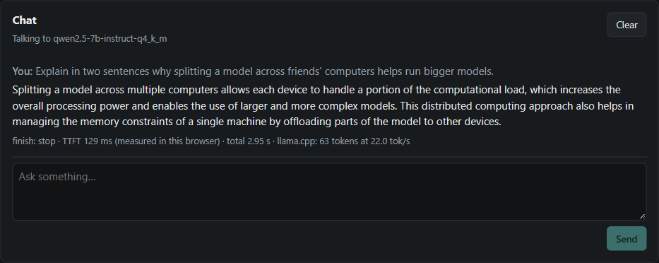
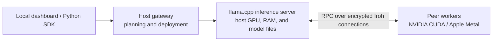

# Hypercompute

**Run local language models across computers you already have.**

Hypercompute is a distributed inference prototype that pools Windows and Linux NVIDIA machines
with Apple Silicon Macs. One computer hosts the session, plans where model layers run, and serves
chat through a local dashboard or API. Other computers join by invitation and contribute memory
and compute.

The goal is to make larger models practical on limited hardware. Pooling helps when it saves more
time reading model weights from disk than it adds in network overhead; it can also be slower than
running on one machine.

[Get started](#get-started) · [How it works](#how-it-works) · [Measured results](#measured-results) ·
[Documentation](#documentation)



*Dashboard capture from an early validation session using a laptop, a second local process, and
a Linux VM. Physical multi-machine measurements are documented below.*

## What it does

- **Plans model placement:** checks device memory and estimates how to split layers across the host and peers.
- **Connects mixed hardware:** carries control and inference traffic over encrypted Iroh connections,
  with direct connections where possible and relay fallback.
- **Manages deployments:** verifies workers, reserves memory budgets, supervises inference processes,
  and records failures and cleanup.
- **Provides a local interface:** a React dashboard for model selection, placement, and streamed chat,
  plus a Python SDK and chat API.
- **Records experiments:** saves deployment and benchmark records so results can be inspected and compared.

**Status:** working prototype with recorded hardware sessions through October 25, 2026.
Performance depends on the model, memory layout, and network. See [limitations](#limitations).

## How it works

Hypercompute uses **llama.cpp for inference** and **Iroh for encrypted transport**. Its Python/FastAPI
gateway coordinates peers, plans placement, supervises deployments, and exposes the dashboard and API.



The host keeps the model file and runs the inference server. Peers execute assigned layers and
can cache their weights locally. Before a deployment becomes ready, Hypercompute checks that
the engine actually placed work on the peers assigned by the plan.

Each peer adds network latency during token generation. The planner estimates the tradeoff;
those estimates need measurement on the actual hardware. See the
[architecture and deployment lifecycle](docs/PROJECT_GUIDE.md#how-it-works) for the full design.

## Get started

Start with a small model on one host, then add peers. This checks installation and the chat path
before introducing networking or large model downloads.

### 1. Prepare the host

Install Git, [uv](https://docs.astral.sh/uv/getting-started/installation/), and Node.js 22 or 24 with npm.
The checkout pins Python 3.12; uv can install it if needed. Prebuilt standard runtimes cover
Windows x64, Linux x64, and Apple Silicon macOS. See the
[platform setup notes](docs/PROJECT_GUIDE.md#setup-on-any-machine) for GPU drivers and hardware
that needs a source build, including the measured Linux arm64 GB10 setup.

```bash
git clone https://github.com/amemon12/Hypercompute.git
cd Hypercompute
uv sync --locked
uv run hypercompute engine install --yes
npm --prefix frontend ci
npm --prefix frontend run build
uv run hypercompute models pull qwen2.5-0.5b-instruct-q4_k_m
```

The engine and model commands download checksum-verified files. Runtime data is normally stored
under `~/.hypercompute/`.

### 2. Start a local session

```bash
uv run hypercompute host --transport iroh --port 8001
```

Open [http://127.0.0.1:8001](http://127.0.0.1:8001) on the host. Select the downloaded model,
**Check plan**, then **Run together**. Chat becomes available when the deployment reaches **Ready**.

The explicit flags matter: the CLI otherwise defaults to LAN transport and port 8000.
The launch scripts and Python SDK use port 8001.

### 3. Add another computer

In a second terminal on the host, create a separate invite for each peer:

```bash
uv run hypercompute invite --port 8001
```

Send the invite privately. On the peer, use the matching checkout and the
[join script for its operating system](join/README.md#for-a-friend-three-steps). The script prompts
for the invite and the memory budget before sharing starts. Invites expire after 15 minutes
and can be used once. Every machine in a pool must use the same engine release.

When the peer shows **Ready to contribute**, stop the local deployment and select the peer.
Under **How to split the work**, choose **Run together (every selected friend gets layers)**,
then **Check plan** and start the deployment. This explicitly tests peer participation;
the default **Fastest that fits** strategy can keep the tiny model entirely local.
Adding peers is not expected to make this starter model faster. The
[host and peer guide](join/README.md) covers launchers, stopping, and troubleshooting.

## Measured results

These are recorded experiments, not general performance guarantees. This comparison used a
Windows ROG Zephyrus G14 (RTX 5070 Ti Laptop GPU, 12 GB VRAM, about 31 GiB RAM) alone and with
two M4 MacBook Airs (16 GiB each, up to 10.5 GiB contributed each), connected directly over Iroh
on a home network.

| Model and quantization | Decode on host alone | Decode with peers | Measured repetitions: alone / pooled |
| --- | ---: | ---: | ---: |
| Llama 3.3 70B Instruct, Q4_K_M | 0.165 tokens/s | 0.898 tokens/s | 2 / 2 |
| gpt-oss-120b, MXFP4 | 3.829 tokens/s | 8.740 tokens/s | 3 / 3 |
| Qwen3-Next-80B-A3B, Q3_K_M | 21.373 tokens/s | 10.005 tokens/s | 6 / 3 |

The first two models benefited from reduced disk reads. The Qwen model already fit the host and
became slower with peers. Even with pooling, the 70B model generated fewer than one token per second.

The 70B test requested 64 prompt tokens and 32 output tokens; the other two requested 128 and 64.
Each model has one pooled run. The 70B and 120B comparisons each have one host-only run; Qwen has two.
Repetitions within a load do not establish repeatability across sessions. Network round trips ranged
from 5–8 ms before pooled runs to as high as 46 ms afterward.

Sources: [measurement conditions and caveats](docs/pitch/NUMBERS.md),
[complete benchmark tables](bench/RESULTS.md), and
[run methodology](docs/research/PAPER-RUNS-2026-10-22.md). Those documents also cover GX10-hosted
experiments where pooling was slower or approximately tied with host-only decode.

## Limitations

- **Hardware results cover short prompts.** The measured runs requested 64 or 128 prompt tokens;
  longer contexts may behave differently. Output quality was not benchmarked, including for
  the heavily quantized models in the larger experiments.
- **Cold pooled starts are expensive.** Recorded peer seeding and loading took roughly 15–32 minutes
  in the tested configurations. Cached loads can differ.
- **Planner estimates are imperfect.** Estimates calibrated on the laptop did not reliably predict
  GX10 performance. Memory budgets are planning limits, not operating-system-enforced quotas.
- **A missing peer interrupts the deployment.** There is no live migration; restart after the peer returns.
- **Participants must trust one another.** The host sees prompts and answers; peers see the activations
  they process. Iroh encrypts transport. Raw LAN worker RPC has no authentication and requires a
  trusted, restricted network. See the [security model](docs/PROJECT_GUIDE.md#security-model).

## Development

After installing dependencies with `uv sync --locked` and `npm --prefix frontend ci`, run:

```bash
uv run python -m pytest -q
uv run ruff check backend tests scripts join sdk bench
npm --prefix frontend test
npm --prefix frontend run typecheck
npm --prefix frontend run build
```

The default backend suite excludes hardware tests and needs no GPU or model download. Hardware tests,
packaging checks, and development servers are documented in the
[development reference](docs/PROJECT_GUIDE.md#development).

| Directory | Purpose |
| --- | --- |
| `backend/hypercompute/` | Gateway, peer agent, planner, transport, and runtime adapters |
| `frontend/` | React/TypeScript inference dashboard; separate website in `frontend/website/` |
| `join/`, `app/`, `sdk/python/` | Launch scripts, local demo app, and Python client |
| `bench/`, `results/` | Benchmark tooling and recorded evidence |
| `tests/`, `docs/` | Protocol tests, engine fixtures, and technical documentation |

## Documentation

| Guide | What you'll find |
| --- | --- |
| [Project guide](docs/PROJECT_GUIDE.md) | Detailed measurements, architecture, dashboard tour, commands, and troubleshooting |
| [Host and peer setup](join/README.md) | Launchers, consent, contributed resources, and stopping a session |
| [Python SDK](sdk/python/README.md) · [Gateway API](docs/API.md) | Programmatic deployment and chat |
| [Benchmark guide](bench/README.md) | Planning, running, and reporting experiments |
| [Engine support](docs/ENGINE_TIERS.md) · [Networking](docs/iroh-networking.md) | Runtime compatibility, placement tiers, and transport |
| [Operational runbook](docs/RUNBOOK.md) | Per-OS setup and engine debugging |
| [Website](frontend/website/README.md) · [Optional integrations](docs/PROJECT_GUIDE.md#sponsor-integrations) | Separate website and integration examples |

No project license has been selected. See [third-party attribution](docs/ATTRIBUTION.md)
for the components and models used by Hypercompute.
