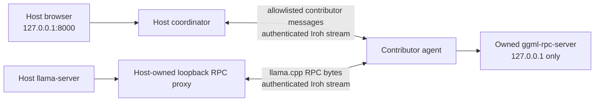

# Connecting through Iroh

Iroh is an opt-in transport for connecting Hypercompute contributors when the machines cannot reach each
other directly over the LAN. It carries Hypercompute's contributor messages and llama.cpp RPC traffic over
authenticated, encrypted streams. It does not install a VPN interface or require a Tailscale account.

**Validation scope (21 October 2026):** a Windows RTX laptop and a physical Apple M4 Mac completed real
Qwen2.5 0.5B and 32B split-model inference over an observed Iroh relay path. Streaming, non-streaming,
and request cancellation followed by successful recovery passed for the small model. The 32B proof used
host RAM plus both GPUs and two short streamed prompts; physical restart/reconnection and disk-tier
32B inference still require separate validation.

## Choose the connection mode

| Mode | Host | Contributor | Intended use |
| --- | --- | --- | --- |
| LAN, the default | `uv run hypercompute host` | `uv run hypercompute join --host HOST-IP:8000 --code CODE` | Machines can reach each other on a trusted network |
| Iroh, opt-in | `uv run hypercompute host --transport iroh` | `uv run hypercompute join --ticket HOST-TICKET --code CODE` | Direct LAN connections are unavailable or unreliable |

Omitting `--transport` preserves the existing LAN behavior. A ticket selects the Iroh connection path; it
does not replace the invitation code. Use either `--host` or `--ticket` for a contributor, not both.

The initial Iroh path targets the pinned **llama.cpp RPC worker**. It is not a general tunnel for arbitrary
applications, and it should not be treated as an EXO discovery or distributed MLX transport. Local engine
selection and transport support are separate concerns. `--ticket` cannot be combined with `--exo` or
`--advertise-ip`; the contributor's RPC worker uses loopback in this mode.

## Prepare both machines

Use compatible Hypercompute versions and the same pinned llama.cpp release on both machines. From the
repository directory on each machine:

```sh
uv sync
uv run hypercompute engine install --yes
uv run hypercompute doctor
```

Only the host needs the model files. The host also needs the built dashboard:

```sh
uv run hypercompute models pull qwen2.5-0.5b-instruct-q4_k_m
npm --prefix frontend ci
npm --prefix frontend run build
```

On Windows PowerShell, use `npm.cmd` if the execution policy prevents `npm` from running. Start with the
small model to check connection, verification, loading, generation, and shutdown before transferring a
large model's layers.

## Start the host and invite one contributor

On the host:

```sh
uv run hypercompute host --transport iroh
```

Keep this process running. Open the owner dashboard on the host at `http://127.0.0.1:8000/`. Owner operations
remain local: Iroh does not forward the dashboard, owner token bootstrap, deployment controls, or chat API
to contributors. The Iroh host's HTTP gateway listens on loopback by default.

Generate a fresh invitation in another terminal on the host:

```sh
uv run hypercompute invite
```

If the host uses a different dashboard port, select it with `uv run hypercompute invite --port PORT`.

Use the complete join command printed by the host. It contains the host's ticket and the invitation code:

```sh
uv run hypercompute join --ticket '<HOST-TICKET>' --code '<XXXXX-XXXXX>'
```

The ticket supplies the address and identity needed to contact this host. The code authorizes one join.
Codes expire after 15 minutes and work once; each contributor needs a fresh code. Keep the complete join
command private until it is used. Do not paste tickets and live codes into public issues or commit them.

On an Apple Silicon Mac, keep the machine plugged in and awake during the session. For example:

```sh
caffeinate -dims uv run hypercompute join --ticket '<HOST-TICKET>' --code '<XXXXX-XXXXX>' --cache
```

The contributor still sees the detected devices and proposed contribution and confirms it before sharing.
Existing options such as `--name`, `--max-memory`, `--reserve`, `--devices`, `--cache`, and `--yes` retain their
meaning. Memory limits are admission budgets, not operating-system-enforced memory quotas. `--cache` keeps
received tensors on the contributor's disk to make later loads faster.

Wait for the contributor to become **Ready to contribute**. This requires a real llama.cpp handshake over
the transport; a connected Iroh peer alone is not sufficient. Choose the model and contributor in the
dashboard, check the plan, run together, and send a short chat message once the deployment is ready.

## Use your own relay

The prototype uses public Iroh relays by default. You do not need to run a separate account service or
short-code rendezvous service: the invitation command includes the host's ticket. The host can select an
explicitly configured relay instead:

```sh
uv run hypercompute host --transport iroh --relay-url https://relay.example.com
```

The URL must point to a compatible, reachable Iroh relay service. An ordinary HTTP reverse proxy or an
arbitrary website is not a relay. Share a fresh ticket after changing the host's relay configuration.
The contributor can also select its relay with `join --ticket HOST-TICKET --code CODE --relay-url URL`.

A relay helps establish connectivity when direct paths fail. It does not make the network local: relayed
model transfers and per-token computation may have substantially higher latency and lower throughput.
Place a self-hosted relay near the participating machines and measure the actual path before relying on
it for a large model.

There is no `--relay-only` option in this implementation. The pinned Python binding does not expose a
supported switch to force all traffic through a relay. Selecting `--relay-url` therefore does not prove
that payloads used that relay. Do not label a test "relay validated" without evidence of the path taken.

## What connects to what



The host allocates its local proxy endpoint. The contributor does not nominate a destination on the host's
loopback network. On the contributor, incoming RPC streams may reach only the worker started and owned by
that agent. The worker is bound to loopback rather than a public or LAN interface.

This avoids exposing llama.cpp's unauthenticated RPC listener to other machines on the Wi-Fi. It does not
protect the listener from other processes already running on the same computer. The host remains trusted
to place model layers and run computation within the contributor's agreed budget.

## Identity and access boundaries

- The authenticated Iroh peer key identifies the transport peer. A ticket does not authorize session
  membership; the existing one-use invitation still gates enrollment.
- A joined node is bound to its peer key. Credentials for an Iroh node must not authenticate a different
  peer or bypass this binding through the LAN HTTP API.
- Contributor methods are explicitly allowlisted. A peer cannot request owner operations, arbitrary HTTP
  forwarding, or a connection to a caller-supplied local address or port.
- Persisted peer bindings and local endpoint keys are runtime state. Keep them with the runtime state they
  belong to; copying an identity to another machine creates an identity collision rather than a new peer.
- Removing a node or closing a session must invalidate its access and shut down affected active proxy
  streams, not merely prevent a later connection.

## Pause, resume, leave, and failures

The contributor retains the existing local controls:

```sh
uv run hypercompute pause
uv run hypercompute resume
uv run hypercompute leave
```

Ctrl+C also stops sharing. To discard cached tensors when leaving:

```sh
uv run hypercompute leave --purge-cache
```

Pausing or losing a contributor during a deployment fails that deployment; there is no live migration of
its layers. Resume or reconnect, wait for verification, then create a new deployment. Losing connectivity
does not justify leaving an unrestricted proxy or worker running indefinitely.

The existing lifecycle deadlines remain relevant: heartbeats normally run every 3 seconds, the host marks
a contributor stale after 15 seconds without a heartbeat, and the contributor stops sharing after the
host has been unreachable for 5 minutes. A fresh transport connection must still pass the current node
authorization checks. Restarting the host does not turn a stored node directly into a ready worker.

## Troubleshooting and validation

| Symptom | Check |
| --- | --- |
| The ticket cannot be parsed | Copy the full current join command, including the ticket and separate code; avoid line wrapping or truncation |
| Invitation refused | Ask the host for a fresh invitation; codes are single-use and expire |
| Transport cannot connect | Confirm the host is running, both machines have internet access, and any custom relay is reachable and compatible |
| Transport connects but the node is not ready | Inspect engine identity and the RPC verification result; transport connectivity does not prove a usable worker |
| Connection worked before a restart | Confirm the same runtime identity is present; retry with a fresh invitation when required rather than deleting unrelated runtime state |
| Loading or generation is slow | Compare a small-model run with LAN and record latency/throughput; relay selection alone does not identify the active path |
| `doctor --host` fails | This checks a LAN HTTP address. It is not an Iroh ticket diagnostic |

Run the two transport smoke scripts from a repository checkout; neither needs a model or GPU:

```sh
uv run python scripts/check_iroh_transport.py --local
uv run python scripts/check_iroh_peer.py
```

The first uses separate processes and real QUIC sockets to check peer identity and message exchange. Omit
`--local` to exercise public relay bootstrap and print the observed connection path, or pass `--relay-url URL`.
The second checks real join/leave services, invitation and credential rejection, denial of owner methods,
and the fixed-destination RPC bridge using a temporary TCP echo worker. Both keep their state in temporary
directories and clean up their processes.

The earlier same-machine Windows check used separate host and CPU contributor processes and completed
real inference over a direct path. The initial physical test used the Windows RTX 5070 Ti laptop and
the M4 Mac's Metal worker with Qwen2.5 0.5B Q4_K_M, context 1024, and llama.cpp b11770. The deployment
reported verified participation: the Mac held one layer, 10.38 MiB of model weights and 0.50 MiB of KV
cache; 23 layers remained on the host GPU. The selected Iroh path was `relay`.

| Physical test | Observed result |
| --- | --- |
| Streamed capital-of-France question | Correct answer; 264 ms to first token, 8 output tokens in 634 ms total |
| Non-streamed arithmetic question | Correct answer (`156`) in 393 ms total |
| Cancel an active stream, then request again | Cancellation recorded; the next request returned the correct answer (`4`) |

The same physical pair then completed a repeat benchmark at context 4096, with three measured repetitions
per prompt and zero failures:

| Prompt | Median time to first token | Median decode rate |
| --- | --- | --- |
| Short | 153 ms | 33.50 tokens/s |
| Long, 3,528 input tokens | 51.07 seconds | 28.47 tokens/s |

The short-request measurements above are client-observed; the repeat table uses recorded benchmark
metrics. Neither is a throughput guarantee. Long inputs were much slower to reach the first token even
though subsequent decoding remained responsive. Idle selected-path RTT was approximately 17–24 ms;
during a longer prompt it rose to about 1 second. Measure prompt processing as well as decoding before
using larger contexts over a relay. This small model also fits the host alone, so the test demonstrates
remote execution rather than a capacity advantage. Evidence is saved in `physical-qwen.json`,
`physical-cancellation.json`, and `physical-qwen-benchmark.json` under the test machine's
`~/.hypercompute/transport-validation/` directory.

Physical pause/resume, removal, host restart, and interrupted-connection recovery still need separate
checks. Keep same-machine and two-physical-machine results distinct.

### 32B with host RAM and both physical GPUs

Qwen2.5-32B-Instruct Q4_K_M (18.49 GiB of verified GGUF files) completed two streamed requests at
context 1024 on the same Windows/M4 pair. Observed placement matched the plan: 28 CPU layers, one Mac
layer, and 35 CUDA layers plus the output head. Model buffers were 8248.58 MiB CPU, 297.72 MiB Mac,
and 10379.71 MiB CUDA. This is a real remote execution proof, not evidence that the host cannot run
32B alone using RAM or disk offload; a comparable local-only run was not tested.

| Uncached prompt | Answer | Client TTFT | Total time | Output tokens | Engine decode rate |
| --- | --- | --- | --- | --- | --- |
| Capital of France, one sentence | The capital of France is Paris. | 1.728 s | 3.121 s | 8 | 5.03 tokens/s |
| 12 multiplied by 13, number only | 156 | 1.601 s | 2.163 s | 4 | 5.35 tokens/s |

These are two short correctness probes, not a repeated throughput benchmark. Loading took 315.19 seconds,
mostly transferring the Mac's weights through a roughly 1 MiB/s relay. The explicit trial layout minimized
remote upload; it was not a saved tuning profile. The host's automatic 20% application reserve (6.22 GiB)
was lowered to the existing 4 GiB minimum for this trial only. CPU weights, KV and working buffers were
still charged to RAM; the Mac retained its 4 GiB reserve and 10 GiB sharing cap. A one-second sampler
covering the end of transfer, CPU loading and inference observed at least 5.033 GiB available host RAM
and a peak sampled child working set of 8.622 GiB.

An earlier disk-tier attempt was stopped for memory pressure. The successful resident trial used
`--load-mode none --no-host --no-repack`; the adapter now selects these flags automatically for feasible
Windows RAM-tier plans with CPU layers. It retains file-backed loading for disk-tier plans. The proof
ran in a standalone loopback engine through the existing host's RPC bridge, so it does not validate a
restarted gateway or show a ready deployment in the dashboard. Evidence is in
`~/.hypercompute/transport-validation/resident-diagnostic-20261022T013503Z-175039/`
(`proof.json`, `memory-observation.json`, and `llama-server.log`).

See [the runbook](RUNBOOK.md) for engine setup and the existing LAN flow, and
[implementation status](IMPLEMENTATION_STATUS.md) for the evidence supporting other features.
