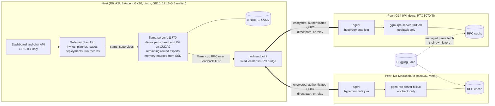
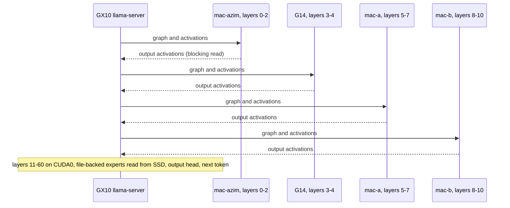
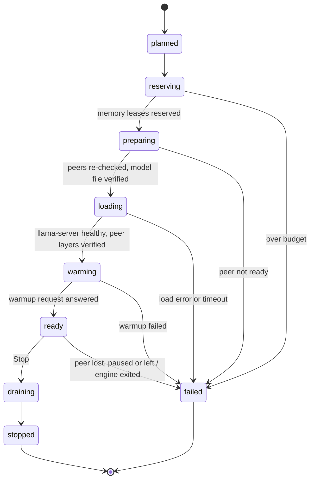
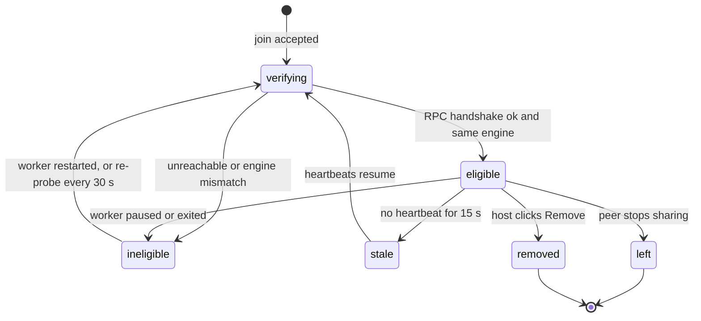

<!-- Draft replacement for the repo-root README.md (2026-10-24). Links are relative to the repo root. -->

# Hypercompute

**Multiplayer computing.**

Hypercompute lets friends' machines join one encrypted pool (an Iroh QUIC tunnel and a one-use invite) and run open
models that fit in no single machine's memory. It runs on stock llama.cpp b11770 RPC, with a planner that places
whole layers and MoE experts across machines, RAM and SSD, peers that download their own slice from Hugging Face, and
Windows CUDA, Linux GB10 and macOS Metal machines in one pool.


> **Status, 2026-10-24.** Working prototype, measured on real machines. A 671B and a 1T model ran on an ASUS Ascent
> GX10 with a Windows gaming laptop and three MacBook Airs as peers. A 120B and a 235B model ran on the laptop with
> the Macs. A laptops-only sweep from 24B to 1T and a concurrency test are being measured. Method and per-run
> tables: [docs/research/PAPER-RUNS-2026-10-22.md](docs/research/PAPER-RUNS-2026-10-22.md) (runs R1 to R6).

## Contents

1. [Results](#results)
2. [How it works](#how-it-works)
3. [Quick start](#quick-start)
4. [Supported platforms](#supported-platforms)
5. [Reproduce the paper runs](#reproduce-the-paper-runs)
6. [Limits and costs](#limits-and-costs)
7. [Security model](#security-model)
8. [Command reference](#command-reference)
9. [Troubleshooting](#troubleshooting)
10. [Repository layout](#repository-layout)
11. [Development](#development)
12. [Project status](#project-status)
13. [More documentation](#more-documentation)

---

## Results

What pooling changed, across every pooled configuration measured so far. Pooled means the G14 with 1 or 3 M4
MacBook Airs (120B), the G14 with 3 Airs (235B), or the GX10 with the G14 and 3 Airs (671B, 1T).

* **Prompt reading (prefill) was faster in every pooled configuration:** from 1.48x the host alone (gpt-oss-120b,
  G14 + 1 Mac, 128-token prompt) to 2.99x (gpt-oss-120b, G14 + 3 Macs, 128-token prompt).
* **The first token arrived sooner in every pooled configuration:** from 0.37x of the host-alone time (gpt-oss-120b,
  G14 + 3 Macs, 128-token prompt) to 0.68x (Kimi-K2.6 1T, GX10 + 4 peers, 64-token prompt).
* **SSD reads per generated token fell 46% to 95%:** 46% on gpt-oss-120b with the G14 + 1 Mac, 95% on the 671B with
  the GX10 + 4 peers.
* **Decode was faster only in the laptops-only pool:** 1.27x [1.10, 1.46] on the 120B with three Macs, 1.25x
  [1.11, 1.41] with one. On the 235B with three Macs it was 1.08x [0.98, 1.18] at steady state (runs 3 to 6), an
  interval that includes parity. On the GX10 host, decode was slower pooled: 0.83x on the 671B and 0.86x on the 1T.
* **Every pooled model here (120B, 235B, 671B, 1T) also ran on one machine alone.** In the alone runs below, each
  paged MoE experts from that machine's SSD. Pooling changes how long you wait.

### Big host: ASUS Ascent GX10 alone vs GX10 + G14 + 3 MacBook Airs (R6, 2026-10-24)

Home Wi-Fi, one subnet. 64-token prompt, 32-token answer, 1 warmup and 2 measured reps per run, 2 runs per arm, so
4 vs 4 reps. Tier `moe_offload`. Ratios are pooled / alone with a 95% bootstrap interval.

| Model | Config | First token, s | Full answer, s | Prefill tok/s | Decode tok/s | SSD MiB / token | Load, s |
|---|---|---|---|---|---|---|---|
| DeepSeek-V3.1 671B (UD-TQ1_0, one 170.5 GB file) | GX10 alone | 24.67 | 41.84 | 2.63 | 1.805 | 684 | 239, 256 |
| | GX10 + 4 peers | 10.36 (0.420 [0.373, 0.462]) | 31.20 (0.746 [0.694, 0.797]) | 6.36 (2.42x [2.19, 2.72]) | 1.497 (0.83x [0.77, 0.90]) | 37 (0.054x [0.026, 0.097]) | 503 after 1416 s seeding; 517 after 856 s seeding |
| Kimi-K2.6 1T (IQ1_S, 193.16 GiB, 1026B parameters, 32B active) | GX10 alone | 28.25 | 45.48 | 2.19 | 1.799 | 671 | 257, 266 |
| | GX10 + 4 peers | 19.08 (0.675 [0.629, 0.728]) | 39.23 (0.863 [0.818, 0.912]) | 3.30 (1.51x [1.41, 1.59]) | 1.540 (0.86x [0.82, 0.89]) | 254 (0.38x [0.37, 0.40]) | 367 after 676 s seeding; 369 after 5 s seeding (cache warm) |

Peers: the G14 (CUDA0, at most 9 GiB), mac-a and mac-b (Metal, 11.5 GiB caps) and mac-azim (Metal, 7.5 GiB cap).
mac-azim stayed on the Iroh relay (47 to 84 ms) in both 671B pooled runs, so the 671B pooled decode is a lower bound
for four direct peers. All four peers were direct in the Kimi pooled runs (RTT 6 to 51 ms). The two 671B pooled runs
used two different peer orders over the same layer sizes; their reps are pooled together.

### Laptops only: G14 alone vs G14 + M4 MacBook Airs (R1 and R2, 2026-10-22 to 23)

Building Wi-Fi, laptops on different subnets, Iroh direct through NAT (RTT 12 to 134 ms during setup). Each Mac
contributed at most 7.5 GiB.

| Model | Config | Prompt / answer, reps | First token, s | Full answer, s | Prefill tok/s | Decode tok/s | SSD MiB / token |
|---|---|---|---|---|---|---|---|
| gpt-oss-120b (MXFP4, 59.03 GiB) | G14 alone | 128 / 64, 9 | 36.17 | 54.44 | 3.68 | 3.296 | 275 |
| | G14 + 1 Mac | 128 / 64, 6 | 23.97 (0.663 [0.627, 0.696]) | 38.81 (0.713 [0.678, 0.750]) | 5.45 (1.48x [1.41, 1.57]) | 4.130 (1.25x [1.11, 1.41]) | 148 (0.54x [0.52, 0.56]) |
| | G14 + 3 Macs | 128 / 64, 9 | 13.44 (0.371 [0.325, 0.424]) | 27.93 (0.513 [0.453, 0.577]) | 11.03 (2.99x [2.64, 3.35]) | 4.198 (1.27x [1.10, 1.46]) | 41 (0.15x [0.12, 0.19]) |
| Qwen3-235B-A22B (UD-Q2_K_XL, 82.67 GiB), steady state, runs 3 to 6 | G14 alone | 64 / 64, 9 | 43.50 | 92.91 | 1.450 | 1.294 | 647 |
| | G14 + 3 Macs | 64 / 64, 9 | 27.86 (0.641 [0.595, 0.695]) | 73.25 (0.788 [0.739, 0.845]) | 2.333 (1.61x [1.48, 1.74]) | 1.396 (1.08x [0.98, 1.18]) | 296 (0.46x [0.42, 0.49]) |

Loads: 120B alone 38 to 44 s, 1 Mac 72 and 80 s, 3 Macs 126 s (after 566 s of seeding), 158 s and 167 s. 235B alone
44 to 54 s (all runs), 3 Macs 130 to 175 s with warm peer caches (D2, D4 to D6); the 2289 s cold load is under
[Load times](#limits-and-costs).

Confound: a code workflow shared the G14 during six of the eight measured 120B runs, including the last two 3-Mac
runs; the third 3-Mac run is likely pessimistic.

### One machine alone (R4, 2026-10-23)

| Model | Machine | Prompt / answer, reps | First token, s | Prefill tok/s | Decode tok/s | SSD MiB / token |
|---|---|---|---|---|---|---|
| DeepSeek-V3.1 671B | G14 alone (RTX 5070 Ti 12 GiB, 31.1 GiB RAM) | 64 / 32, 2 | 88.68 | 0.747 | 0.481 | 2485 |

The layout analysis predicted 0.48 tok/s and 2002 to 2392 MiB per token for this case before it ran.

### Being measured

**Laptops-only sweep (R7, 2026-10-25): 24B to 120B in the queue, 70B to 120B measured so far.** Same method as the tables above, host alone vs the
laptops-only pool. Measured rows come from run.json via `stats.py` and `ttft_stats.py`; rows still in `[SWEEP: ...]`
form are queued and not measured yet. The 671B and 1T were measured only with the GX10 as host (table above, and
[docs/pitch/NUMBERS.md](docs/pitch/NUMBERS.md) section 3), and the 235B laptops-only result is the R1 row above. None
of the three was in tonight's laptop sweep. Ratios are pooled / alone with a 95% bootstrap interval.

| Sweep key | Model | Pool | First token, alone vs pool | Prefill tok/s, alone vs pool | Decode tok/s, alone vs pool | SSD MiB / token |
|---|---|---|---|---|---|---|
| d24q4 | Mistral-Small-3.2-24B (Q4_K_M) | [SWEEP: d24q4 pool] | [SWEEP: d24q4 laptops-pool first token] | [SWEEP: d24q4 laptops-pool prefill] | [SWEEP: d24q4 laptops-pool decode] | [SWEEP: d24q4 laptops-pool SSD] |
| d24q8 | Mistral-Small-3.2-24B (Q8_0) | [SWEEP: d24q8 pool] | [SWEEP: d24q8 laptops-pool first token] | [SWEEP: d24q8 laptops-pool prefill] | [SWEEP: d24q8 laptops-pool decode] | [SWEEP: d24q8 laptops-pool SSD] |
| gm27 | Gemma 3 27B (Q4_K_M) | [SWEEP: gm27 pool] | [SWEEP: gm27 laptops-pool first token] | [SWEEP: gm27 laptops-pool prefill] | [SWEEP: gm27 laptops-pool decode] | [SWEEP: gm27 laptops-pool SSD] |
| d32 | Qwen2.5-32B Instruct (Q4_K_M) | [SWEEP: d32 pool] | [SWEEP: d32 laptops-pool first token] | [SWEEP: d32 laptops-pool prefill] | [SWEEP: d32 laptops-pool decode] | [SWEEP: d32 laptops-pool SSD] |
| qwq32 | QwQ-32B (Q4_K_M) | [SWEEP: qwq32 pool] | [SWEEP: qwq32 laptops-pool first token] | [SWEEP: qwq32 laptops-pool prefill] | [SWEEP: qwq32 laptops-pool decode] | [SWEEP: qwq32 laptops-pool SSD] |
| d70 | Llama 3.3 70B Instruct (Q4_K_M, dense) | G14 + mac-a + mac-b | 10.01 vs 5.02 s (0.500 [0.480, 0.523]) | 6.361 vs 12.514 (1.967x [1.896, 2.043]) | 0.165 vs 0.898 (5.444x [5.423, 5.464]) | 23454.2 vs 2761.2 (0.118x [0.118, 0.118], 2 reps in one row per side) |
| r70 | DeepSeek-R1-Distill-Llama-70B (Q4_K_M) | [SWEEP: r70 pool] | [SWEEP: r70 laptops-pool first token] | [SWEEP: r70 laptops-pool prefill] | [SWEEP: r70 laptops-pool decode] | [SWEEP: r70 laptops-pool SSD] |
| vl72 | Qwen2.5-VL 72B Instruct (Q4_K_M, dense, text only) | G14 + mac-a + mac-b | 13.70 vs 9.11 s (0.664 [0.643, 0.686]) | 4.642 vs 7.221 (1.555x [1.506, 1.608]) | 0.141 vs 0.365 (2.592x [2.571, 2.613]) | 26896.2 vs 8956.1 (0.333x [0.333, 0.333], 2 reps in one row per side) |
| n80 | Qwen3-Next-80B-A3B (Q3_K_M, MoE) | G14 + mac-a + mac-b | 1.55 vs 4.32 s (2.771 [2.447, 3.183], pooled later) | 84.348 vs 29.513 (0.350x [0.304, 0.400]) | 21.373 vs 10.005 (0.468x [0.362, 0.611], slower pooled) | 9.97 vs 5.40 (0.541x [0.198, 1.383]) |
| sc109 | Llama 4 Scout 17B-16E (Q4_K_M, 109B MoE) | [SWEEP: sc109 pool] | [SWEEP: sc109 laptops-pool first token] | [SWEEP: sc109 laptops-pool prefill] | [SWEEP: sc109 laptops-pool decode] | [SWEEP: sc109 laptops-pool SSD] |
| glm106 | GLM-4.5-Air (Q4_K_M, 106B MoE) | [SWEEP: glm106 pool] | [SWEEP: glm106 laptops-pool first token] | [SWEEP: glm106 laptops-pool prefill] | [SWEEP: glm106 laptops-pool decode] | [SWEEP: glm106 laptops-pool SSD] |
| g120 | gpt-oss-120b (MXFP4, 59.03 GiB) | G14 + mac-a + mac-b, 6 layers per Mac | 34.22 vs 4.83 s (0.141 [0.120, 0.161]) | 3.836 vs 29.764 (7.759x [6.945, 8.855]) | 3.829 vs 8.740 (2.283x [2.000, 2.538]) | 238.3 vs 6.5 (0.027x [0.017, 0.034]) |

Sweep conditions: Host G14 (RTX 5070 Ti Laptop GPU, 11.9 GiB (12 GB), 31.1 GiB RAM). Peers mac-a and mac-b (M4,
16 GiB, 10.5 GiB cap each). Home network, both Macs direct over Iroh, RTT 5 to 8 ms before each pooled row and up to
46 ms after. One pooled row per model. 70B and 72B: 64 / 32, 2 reps per row, one row per side. 120B: 128 / 64, 3
reps, one row per side. 80B: 128 / 64, 3 reps per row, two alone rows against one pooled row (the second pooled row
was refused). A second alone 70B row ran about 9% faster in its warmups before the commit guard stopped it. Pooled
loads 96 to 112 s after 761 to 852 s of peer seeding, against 34 to 42 s alone (PR R7.1 to R7.4).

**Concurrency.** Concurrency with pooling has not been measured yet. `run_big.py --concurrency N` starts
llama-server with N slots sharing one KV pool (`-np N -kvu`), sends N chats at once, and counts tokens only inside
the window where all N are active.

| Config | N | Aggregate decode tok/s | Step time, ms | First token, s |
|---|---|---|---|---|
| G14 alone, gpt-oss-120b, 128 / 64, one row per N (3 reps at N = 1, 3 batches at N = 4 and 8) (PR R7.3, R7.5) | 1 | 3.829 | 261.638 | 34.22 |
| | 4 | 8.095 | 494.299 | 45.99 (mean of 12 chats) |
| | 8 | 12.187 | 659.556 | 59.80 (mean of 24 chats) |
| G14 + mac-a + mac-b, R7.3 layout (`--tensor-split 6,6,25`), home network, same lengths (PR R7.5) | 1 | 8.740 (2.283x [2.000, 2.538]) | 115.550 | 4.83 (0.141 [0.120, 0.161]) |
| | 4 | 11.854 (1.464x [1.295, 1.674]) | 340.621 | 21.17 (0.460 [0.390, 0.523]) |
| | 8 | 16.445 (1.349x [1.246, 1.479]) | 489.300 | 30.80 (0.515 [0.496, 0.535]) |

### How the numbers were measured

* Every number in the tables above comes from a `run.json` written by `scripts/capacity/run_big.py`, indexed in
  `results/capacity/paper-2026-10-2*/index_*.jsonl`.
* Decode tok/s is the engine's own timing, (predicted_n - 1) / predicted_ms, over measured reps only. Warmups are
  excluded.
* First token and full answer are measured by the client, from sending the request to the first streamed token and
  to the last one, through the gateway's `/v1/chat/completions`. Both are recomputed from the per-rep values in each
  `run.json`; PAPER-RUNS does not tabulate them yet.
* Prompts are fixed length with `ignore_eos`, temperature 0, seed 7, no prompt cache. Measured prompts were 58 to 133
  tokens.
* SSD MiB per token is system-wide physical reads from the first streamed token to the last, divided by decode steps.
* Ratios are ratio of means with a 95% percentile bootstrap interval (10,000 resamples, seed 7), resampling reps
  within each group.
* llama.cpp b11770 (commit 39da130fc, RPC protocol 8.0.0) on every machine.

---

## How it works

There are two kinds of traffic. In Iroh mode both travel over the peer's Iroh connection. The **control plane**
(Hypercompute's own API) handles invites, joining, heartbeats, plans and seeding. The **data plane** is llama.cpp's RPC protocol: the host's `llama-server` places each
peer's layers on that peer's `ggml-rpc-server` and asks it to compute them for every token.



Key ideas:

* **One owner per model.** The host runs the only `llama-server` and holds the GGUF file. A peer holds its layers in
  llama.cpp's RPC cache, either received from the host or, for a managed peer, downloaded by the peer itself from
  Hugging Face with ranged reads of exactly the tensors the plan gives it. Each cached tensor is named by the same
  FNV-1a hash llama.cpp's RPC client sends, so at load time the host sends a hash instead of each large weight tensor.
* **Whole layers to peers, experts to SSD.** For a mixture-of-experts model larger than the host's GPU (tier
  `moe_offload`), peers take whole layers (dense part and experts), sized by each peer's budget. The host GPU keeps
  every other layer's attention, norms, router, shared experts, the output head and the KV cache. The routed experts
  that are left stay memory-mapped from the host's NVMe. Peers come first in `--device` and the host GPU last, so the
  vocabulary-sized logits never cross the network.
* **Prefill scales, decode pays per hop.** A prompt is processed in batches, so each peer's GPU runs its layers'
  expert math for many tokens at once. At decode (batch size 1), each peer is one blocking network round trip per
  token, in sequence.
* **Peers are verified before use.** A peer becomes usable only after the host completes a real llama.cpp RPC handshake
  with its worker over the transport. A run counts as pooled only after llama.cpp's own load log shows the peer
  received layers.
* **Iroh transport.** Peers dial the host's Iroh endpoint with a ticket. Iroh holds a direct path through NAT when it
  can and falls back to a relay when it cannot. Workers stay on loopback; the agent bridges one fixed localhost RPC
  port and forwards to nothing else. No VPN account is needed.

### One decode step in the pooled 1T run



The placement behind it (Kimi-K2.6 1T, 193.16 GiB, R6):

| Stage | Machine | Layers | Memory |
|---|---|---|---|
| 1 | mac-azim (M4, Metal) | 0-2 | 6.9 GiB |
| 2 | G14 (RTX 5070 Ti, CUDA) | 3-4 | 6.6 GiB |
| 3 | mac-a (M4, Metal) | 5-7 | 9.9 GiB |
| 4 | mac-b (M4, Metal) | 8-10 | 9.5 GiB |
| 5 | GX10 GPU (CUDA0) | 11-60 | 76.0 GiB |
| 6 | GX10, routed experts file-backed from NVMe | | 83.9 GiB |

### Deployment lifecycle



A failure always records the reason and what was cleaned up (process stopped, leases released). Losing a peer
mid-run fails that run; there is no live migration.

### Peer states



---

## Quick start

### 1. Install on every machine

| OS | Install once |
|---|---|
| macOS (Apple Silicon) | `xcode-select --install`, then `curl -LsSf https://astral.sh/uv/install.sh \| sh` |
| Windows 10/11 x64 | `winget install --id Git.Git -e` and `winget install --id astral-sh.uv -e` |
| Linux x64 / arm64 | `curl -LsSf https://astral.sh/uv/install.sh \| sh` |
| Host only | Node.js 18+ to build the dashboard once |

```bash
git clone https://github.com/amemon12/Hypercompute.git hypercompute
cd hypercompute
uv run hypercompute engine install --yes     # pinned llama.cpp b11770 for this OS and GPU, sha256 verified
uv run hypercompute doctor                   # engine smoke test, addresses, ports, firewall profile
```

`uv` installs its own Python 3.12; nothing touches the system Python. No compiler, CUDA toolkit or WSL is needed for
the release builds. The repository is not public yet: each person needs collaborator access and a GitHub sign-in.

### 2. Host

```bash
cd frontend && npm ci && npm run build && cd ..
uv run hypercompute models list
uv run hypercompute models pull gpt-oss-120b-mxfp4          # every download is checked against its pinned sha256
uv run hypercompute host --transport iroh
```

The dashboard opens at `http://127.0.0.1:8000/` on the host only. In a second terminal on the host, print a join
command for each peer:

```bash
uv run hypercompute invite
```

It prints `uv run hypercompute join --ticket '<HOST-TICKET>' --code '<XXXXX-XXXXX>'`. The ticket says how to reach
the host. The code authorizes one join, works once and expires after 15 minutes. Each peer needs a fresh one. Keep
the command out of chats, issues and commits until it is used.

### 3. Join

```bash
# Any machine
uv run hypercompute join --ticket '<HOST-TICKET>' --code '<XXXXX-XXXXX>' --cache

# A Mac: plugged in, lid open, kept awake
caffeinate -dims uv run hypercompute join --ticket '<HOST-TICKET>' --code '<XXXXX-XXXXX>' --cache

# A managed peer that downloads its own layers from Hugging Face (as in the R6 runs)
uv run hypercompute join --ticket '<HOST-TICKET>' --code '<XXXXX-XXXXX>' --cache --managed --max-disk 100GiB

# A Windows CUDA peer with a fixed budget (the G14 in R6)
uv run hypercompute join --ticket '<HOST-TICKET>' --code '<XXXXX-XXXXX>' --name g14 --devices CUDA0 \
    --max-memory 9GiB --cache --managed --devices-allowed CUDA0 --max-disk 24GiB
```

The agent prints the devices it found and the memory it offers, then asks before sharing (`--yes` skips the prompt).
`--max-memory` and `--reserve` are admission budgets, not OS-enforced quotas. With `--managed`, the host may restart
this machine's worker within `--devices-allowed` and fill its RPC cache up to `--max-disk`; at least 20 GiB of disk
always stays free.

### 4. Run a model

Wait for each peer card to show **Ready to contribute**. Then pick the model, tick the peers, **Check plan**, and
**Run together**. Chat when the stepper reaches **Ready**. **Technical details** shows the per-device buffers
llama.cpp reported.

The host also serves an OpenAI-compatible endpoint, on the host only: `POST http://127.0.0.1:8000/v1/chat/completions`
with the `X-Hypercompute-Owner` token from `GET /api/owner/bootstrap`. API details: [docs/API.md](docs/API.md).

### LAN mode (trusted network only)

Without `--transport iroh`, the host listens on its LAN address and peers join with `--host`:

```bash
uv run hypercompute host                                              # prints: Friends join via: <HOST-IP>:8000
uv run hypercompute join --host <HOST-IP>:8000 --code <XXXXX-XXXXX> --cache
```

On a Windows host, allow port 8000 once per network (Administrator PowerShell):

```powershell
New-NetFirewallRule -DisplayName "Hypercompute gateway" -Direction Inbound -Protocol TCP -LocalPort 8000 -RemoteAddress LocalSubnet -Action Allow
```

In LAN mode each peer's worker listens on TCP 47052, and llama.cpp RPC has no authentication. Use it only on a
network you control. `join` prints commands to restrict the worker to the host's address.

---

## Supported platforms

| OS | Hardware measured | Role measured | Engine build |
|---|---|---|---|
| Windows 11 x64 | ROG Zephyrus G14: RTX 5070 Ti Laptop 12 GiB, 31.1 GiB RAM | Host (R1, R2, R4); CUDA peer (R6) | Pinned release `windows-x64-cuda13.4` (NVIDIA driver R580+) |
| Linux arm64 | ASUS Ascent GX10: NVIDIA GB10, 121.6 GiB unified memory, DGX OS 7.5.0 | Host (R6) | b11770 built from source with `scripts/build_llama_linux.sh --cuda-arch 121`, selected with `HYPERCOMPUTE_LLAMA_BIN_DIR`. The pinned release `linux-arm64-cuda13.4` is not validated on GB10 |
| macOS on Apple Silicon | M4 MacBook Air, 16 GiB unified (macOS 15.7 and 26.6.2) | Metal peer (R1, R2, R6) | Pinned release `macos-arm64` |
| Linux x64 | Not in the paper runs | | Pinned releases for CUDA 13.4, CUDA 12.8, Vulkan and CPU |
| Windows x64 without NVIDIA | Not in the paper runs | | Pinned Vulkan and CPU releases, a labelled fallback |

Every machine in a pool must run the same llama.cpp release (b11770, RPC protocol 8.0.0). The binaries are the
official release archives, sha256-pinned in [configs/engines.lock.json](configs/engines.lock.json), except on GB10,
where b11770 is built from source (same commit 39da130fc, identical version banner).

Models used in the runs are pinned by repo, revision and per-file sha256 in
[configs/models.example.yaml](configs/models.example.yaml): `gpt-oss-120b-mxfp4`,
`qwen3-235b-a22b-instruct-2507-ud-q2_k_xl`, `deepseek-v3.1-ud-tq1_0` and `kimi-k2.6-iq1_s`.

---

## Reproduce the paper runs

Each run goes through the gateway's own HTTP API (plan, explain, deploy, chat, observe, stop), so it exercises the
same planner and deployment path a user does. Evidence lands in `results/capacity/<UTC stamp>-big-<model>/run.json`.

1. **Start the host over Iroh.** The paper runs used port 8001:

   ```bash
   uv run hypercompute host --transport iroh --port 8001 --no-browser
   ```

   On the GX10, `scripts/capacity/paper/gx10/host.sh` does this with `HYPERCOMPUTE_LLAMA_BIN_DIR` set to the source
   build. The host log holds a live invite: never print it whole. Restart the host after any catalog change.

2. **Join the peers** with `--managed --max-disk` so `--seed-peers` can work, using `uv run hypercompute invite
   --port 8001` for each one. `scripts/capacity/paper/gx10/rejoin_mac.sh` and `join_g14.sh` do this over SSH and
   redact the invite. Before a pooled run of a new model, every peer's catalog must list it, then rejoin the peers.

3. **One run by hand:**

   ```bash
   # Host alone
   uv run --no-sync python scripts/capacity/run_big.py --model deepseek-v3.1-ud-tq1_0 --port 8001 \
       --strategy local_only --prompt-tokens 64 --output-tokens 32 --warmup 1 --reps 2

   # Pooled: every joined peer (or --node ID, repeatable), each peer seeding its own layers first
   uv run --no-sync python scripts/capacity/run_big.py --model deepseek-v3.1-ud-tq1_0 --port 8001 \
       --prompt-tokens 64 --output-tokens 32 --warmup 1 --reps 2 --seed-peers --seed-timeout 3600
   ```

   Useful flags: `--layout JSON_OR_PATH` pins an explicit placement, `--plan-only` plans and explains without
   deploying, `--concurrency N` runs N chats at once.

4. **A full matrix, interleaved alone and pooled:**

   ```bash
   python -I scripts/capacity/paper/matrix.py PLAN.json INDEX.jsonl
   ```

   The plans used are in `results/capacity/paper-2026-10-2*/plan_*.json`. On a host other than the G14, set
   `HC_PAPER_REPO`, `HC_PAPER_HOME` and `HC_PAPER_UV`; on a unified-memory host also `HYPERCOMPUTE_LLAMA_BIN_DIR`, and
   `HC_PAPER_PROBE_MACS=0` without SSH keys for the Macs. `scripts/capacity/paper/gx10/matrix.sh` sets all of these.
   Between runs the driver waits for the GPU to drain plus 20 s of heartbeats, and snapshots `/api/network` and each
   Mac's memory, swap, battery and thermal state.

5. **Tables and intervals:**

   ```bash
   HC_PAPER_REPO=$PWD python -I scripts/capacity/paper/summarize.py OUT.md results/capacity/paper-2026-10-24/index_671b_gx.jsonl
   HC_PAPER_REPO=$PWD python -I scripts/capacity/paper/stats.py 671b-gxA 671b-gx4 results/capacity/paper-2026-10-24/index_671b_gx.jsonl
   ```

   `stats.py --batches` resamples concurrent batches instead of single reps.

---

## Limits and costs

**Decode on a big host.** On the GX10, pooling made decode slower: 0.83x [0.77, 0.90] on the 671B and 0.86x
[0.82, 0.89] on the 1T. In llama.cpp b11770 the next stage needs each peer's output, which is a blocking read, so
every peer adds at least one network round trip plus its own compute per token, in sequence. On the building Wi-Fi
of R1 (10 to 25 ms RTT) that was estimated at 30 to 50 ms per Mac per token. The GX10's unified memory keeps far
more of the experts resident than the G14 does, so the SSD reads the peers save cost less than four Wi-Fi stages.
Pools with fewer, larger, direct stages are next to measure.

**Decode on laptops.** The laptops-only pool won on decode on the 120B, where the Macs brought the G14's
file-backed expert set close to its RAM: 1.27x with three Macs, 1.25x with one. It did not improve from one Mac to
three (1.02x [0.86, 1.20]). On the 235B it depends on the host's page cache: cold, the Macs gave 1.338 against
0.875 tok/s; at steady state 1.08x, an interval that includes parity.

**Wi-Fi.** Apartment and guest Wi-Fi that isolate clients force the Iroh relay. In R5, with the G14 on apartment
guest Wi-Fi and the Macs on a phone hotspot (relay only), host-to-Mac uploads ran at about 1 MiB/s, RTT rose to 60
to 580 ms, and a peer dropped mid-load. On home Wi-Fi in R6, one Mac (the only peer on macOS 26) stayed on the relay
in the 671B runs although plain UDP worked both ways; the cause is open. After each host restart (two before the
Kimi runs), every peer, mac-azim included, came back direct. Use a router you control, on 5 GHz.

**Load times.** A big model takes minutes to load, longer pooled:

* GX10 alone: 239 to 266 s for the 671B and the 1T.
* Pooled with cold peer caches: 1416 s of seeding plus a 503 s load (671B), 676 s plus 367 s (1T).
* Pooled with warm peer caches: 5 s of seeding plus a 369 s load (1T).
* Pushing layers from the host instead of seeding: 19.3 GiB to three Macs took 2289 s (8.6 MiB/s, link-bound) on
  the 235B. A Mac fetched from Hugging Face at 13 to 45 MB/s on the same networks, which is why peers seed themselves.
* On Windows, pre-sizing a new 170 GB download zero-filled the file for about 50 minutes and stalled the gateway for
  about 70 s.

For a demo, load before anyone is watching and do not reload.

**Splitting a model that fits costs speed.** If one GPU holds the model, run it there. Qwen2.5 7B Q4_K_M, short
prompt: 80.6 tok/s on the RTX 5070 Ti alone (local_only) vs 25.8 tok/s with 9 of 28 layers on a CPU worker in WSL
on the same laptop ([docs/RESULTS.md](docs/RESULTS.md)).

**The planner's speed estimates are not calibrated per host.** The placement optimizer is checked against a
brute-force oracle in the test suite, but its speed constants come from the G14. On the GX10 it ranked the 671B pool
about 1.77x ahead of the host alone; measured, the pool decoded at 0.83x.

**What has not been measured.**

* Concurrency with pooling: being measured.
* Prompts longer than 133 tokens.
* Output quality. These are 1-bit and 2-bit quantizations; Kimi was spot-checked once (a correct iterative Fibonacci
  function at temperature 0), not benchmarked.

**Small samples.** The GX10 rows are 4 vs 4 reps, and the two 671B pooled runs mixed two peer orders. Read the
intervals as well as the means.

**Operational.** A Mac that sleeps fails the deployment: keep it on AC with `caffeinate -dims`. A peer whose catalog
lacks the model makes the host push its layers at about 4 MiB/s instead of the peer seeding them. Losing a peer
mid-run fails that run.

---

## Security model

* **Iroh mode** carries control and RPC traffic over encrypted, authenticated QUIC streams. The Iroh peer key
  identifies the transport peer; a ticket is not a credential, and the one-use invite code still gates joining. A
  joined node is bound to its peer key. Workers stay on loopback, and the agent forwards only to its own fixed
  localhost RPC port.
* **LAN mode needs a trusted network.** The join code and per-node credentials protect the control plane, but
  llama.cpp's RPC protocol has no authentication: anyone who can reach a worker port can use that GPU.
  Hypercompute never changes firewall settings itself.
* **What each side sees.** The host sees every prompt and answer. Each peer sees the activations that pass through
  its layers.
* The dashboard and chat API answer only on `127.0.0.1`, with a per-start owner token, a Host-header check against
  DNS rebinding, request size limits and anti-framing headers.
* Peers keep local control: Ctrl+C, the Stop button on their local status page, `pause`, or `leave`. If the host
  disappears for 5 minutes (2 hours for a managed peer over Iroh), the peer's worker stops on its own.
* A peer's agent only runs the allowlisted `ggml-rpc-server` binary. With `--managed`, the host may restart that
  worker within `--devices-allowed` and download catalog tensors into its cache within `--max-disk`, both shown
  before the peer confirms.

Details: [docs/iroh-networking.md](docs/iroh-networking.md).

---

## Command reference

| Command | Who | What it does |
|---|---|---|
| `uv run hypercompute host` | host | Start the gateway and dashboard (`--transport lan\|iroh`, `--relay-url`, `--port`, `--bind <ip>`, `--no-browser`, `--local-max-memory 8GiB`, `--local-devices CUDA0`) |
| `uv run hypercompute invite` | host | Print a fresh one-use join command from the running host (`--port`) |
| `uv run hypercompute join --ticket T --code C` | peer | Share this computer over Iroh (`--relay-url`, `--name`, `--max-memory`, `--reserve`, `--devices`, `--cache`, `--yes`, `--managed`, `--devices-allowed`, `--max-disk`) |
| `uv run hypercompute join --host IP:8000 --code C` | peer | Share this computer in LAN mode (`--worker-port`, `--advertise-ip`, plus the options above) |
| `uv run hypercompute pause` / `resume` | peer | Stop the worker but stay in the session / start it again |
| `uv run hypercompute leave [--purge-cache]` | peer | Stop sharing and tell the host; optionally delete the RPC tensor cache |
| `uv run hypercompute status` | both | What this machine is doing (sharing or hosting) |
| `uv run hypercompute doctor [--host IP:8000]` | both | Engine smoke test, addresses, ports, firewall profile, LAN host reachability |
| `uv run hypercompute engine install` / `engine status` | both | Install or inspect the pinned llama.cpp (`--variant`, `--force`, `--yes`) |
| `uv run hypercompute models list` / `models pull ID` | host | Curated models and verified downloads |
| `uv run hypercompute tune MODEL` | host | Measure candidate splits and flags, save the fastest as a measured profile (`--max-candidates`, `--objective`, `--nodes`) |
| `uv run hypercompute inventory` | both | Print this machine's detected hardware as JSON |

---

## Troubleshooting

| Symptom | Likely cause | Fix |
|---|---|---|
| The ticket cannot be parsed | Truncated or wrapped command | Copy the full current join command, ticket and code |
| Invitation refused | Code used or expired | `uv run hypercompute invite` again; codes work once and expire after 15 minutes |
| A peer stays on the relay | NAT or client isolation, or an open issue on one macOS 26 peer | Use a router you control; restart the host once and rejoin |
| Pooled load pushes layers at about 4 MiB/s | The peer's catalog lacks the model, so it cannot seed | Update the peer's catalog, rejoin, then run with `--seed-peers` |
| A run is refused right after another | The previous `llama-server` still holds the GPU | Wait for it to exit; the paper driver waits for the GPU to drain plus 20 s |
| Peer card goes _stale_ | The machine slept or Wi-Fi dropped | `caffeinate -dims` on a Mac, AC power, lid open; rejoin with a new code |
| Plan says _does not fit_ | Not enough contributed memory | Quit apps on the peer and rejoin with a larger `--max-memory`, a smaller quantization or a shorter context |
| `engine mismatch` | Different llama.cpp releases | `uv run hypercompute engine install --yes` on every machine |
| `a Hypercompute host is already running` | A second host on the same machine | Use the running one, or stop it first |
| LAN `join` cannot reach the host | Different networks, client isolation, or Windows blocking port 8000 | Same router for both, the firewall rule above, `uv run hypercompute doctor --host <HOST-IP>:8000` |
| Windows `the worker could not bind` | Port reserved by Hyper-V or WSL | Pass `--worker-port` |

More: [docs/RUNBOOK.md](docs/RUNBOOK.md).

---

## Repository layout

```text
hypercompute/
├── backend/hypercompute/          Python package (the `hypercompute` command)
│   ├── app.py, coordinator.py     FastAPI gateway and service wiring
│   ├── cli.py                     host, join, invite, pause, resume, leave, status, doctor, engine, models, tune, inventory
│   ├── agent/                     peer side: inventory, join and heartbeats, managed worker, RPC cache seeding, local control
│   ├── transport/                 Iroh endpoint, host and guest sides, fixed localhost RPC bridge
│   ├── capacity/                  placement optimizer, cost priors, link and storage probes
│   ├── services/                  sessions, nodes, planner, moe_tier, layout, peer_seed, leases, deployments, streaming, models
│   ├── adapters/                  engine adapters and output parsers
│   ├── engine.py, gguf.py         pinned engine install, GGUF header reader
│   └── schemas.py                 typed contracts shared by everything
├── frontend/                      React + TypeScript dashboard (npm run build -> frontend/dist)
├── configs/                       engines.lock.json, models.example.yaml, profiles.example.yaml
├── scripts/
│   ├── capacity/run_big.py        one end-to-end big-model run through the gateway
│   ├── capacity/paper/            matrix driver, summarize.py, stats.py, Mac and GX10 helpers
│   └── build_llama_*.sh/.ps1      source builds (GB10 needs --cuda-arch 121)
├── tests/                         protocol tests and real llama.cpp fixtures
├── results/                       raw evidence from real runs (results/capacity for the paper runs)
└── docs/                          runbook, research notes, paper runs, API, screenshots
```

Runtime state lives outside the repo in `~/.hypercompute/` (engines, models, databases, logs, RPC caches). Deleting
that folder removes everything Hypercompute created on a machine.

---

## Development

```bash
uv run pytest                      # about 2,000 tests; no GPU needed
uv run pytest -m hardware          # needs the engine and a downloaded model on this machine
uv run ruff check backend tests scripts
cd frontend && npm ci && npm test && npm run typecheck && npm run build
cd frontend && npm run dev         # dashboard dev server on :5173, proxies to a running host on :8000
```

* Work on a branch and open a pull request. Commit messages follow `<type>: <description>`.
* Never commit model files, `.env` files, live tickets or invite codes, or anything from `~/.hypercompute`.
* After a measured session, commit the new `results/` files with the summary that cites them.

---

## Project status

| Area | State |
|---|---|
| Join, heartbeats, invites, layer split, dashboard, failure handling | Done |
| Iroh transport (encrypted QUIC, direct through NAT or relay) | Done; used in every pooled paper run |
| MoE placement: whole layers to peers, experts file-backed on the host SSD | Done; measured on 120B, 235B, 671B and 1T models |
| Managed peers seeding their own layers from Hugging Face | Done; used in the R2 and R6 pooled runs |
| Mixed pool: Windows CUDA, Linux GB10, macOS Metal | Done; measured in R6 |
| Laptops-only sweep, 24B to 1T | Being measured |
| Concurrency with pooling (`run_big.py --concurrency N`) | Being measured |
| Fewer-hop pools (one large direct peer, or two Macs) | Next |
| Per-host calibration of the planner's speed constants | Next |
| Prompts longer than 133 tokens | Not measured |
| Mac peers serving cached weights from mapped SSD files (patched ggml-rpc, opt-in) | Gate passed on one Mac (R3: byte-identical output, Qwen2.5 7B 17.89 tok/s stock vs 17.96 mapped); not used in the runs above |

Development happens on the branch `codex/iroh-transport` (draft PR #3).

## More documentation

| Doc | Contents |
|---|---|
| [docs/research/PAPER-RUNS-2026-10-22.md](docs/research/PAPER-RUNS-2026-10-22.md) | Every measured run (R1 to R6), setup, method and confounds |
| [docs/iroh-networking.md](docs/iroh-networking.md) | Iroh transport, relays, access boundaries |
| [docs/RUNBOOK.md](docs/RUNBOOK.md) | Per-OS commands, troubleshooting, source builds |
| [docs/ENGINE_TIERS.md](docs/ENGINE_TIERS.md) | Tier ladder, engine contract, split rules |
| [docs/API.md](docs/API.md) | Gateway API and auth model |
| [docs/RESULTS.md](docs/RESULTS.md) | Earlier single-host and first-pair measurements |
| [docs/SOURCE_AUDIT.md](docs/SOURCE_AUDIT.md) | Pinned versions and the llama.cpp behavior the code relies on |
| [docs/ATTRIBUTION.md](docs/ATTRIBUTION.md) | Third-party licenses |

**License:** none chosen yet, so all rights are reserved by default. Third-party components keep their own licenses
(llama.cpp MIT); see [docs/ATTRIBUTION.md](docs/ATTRIBUTION.md).
