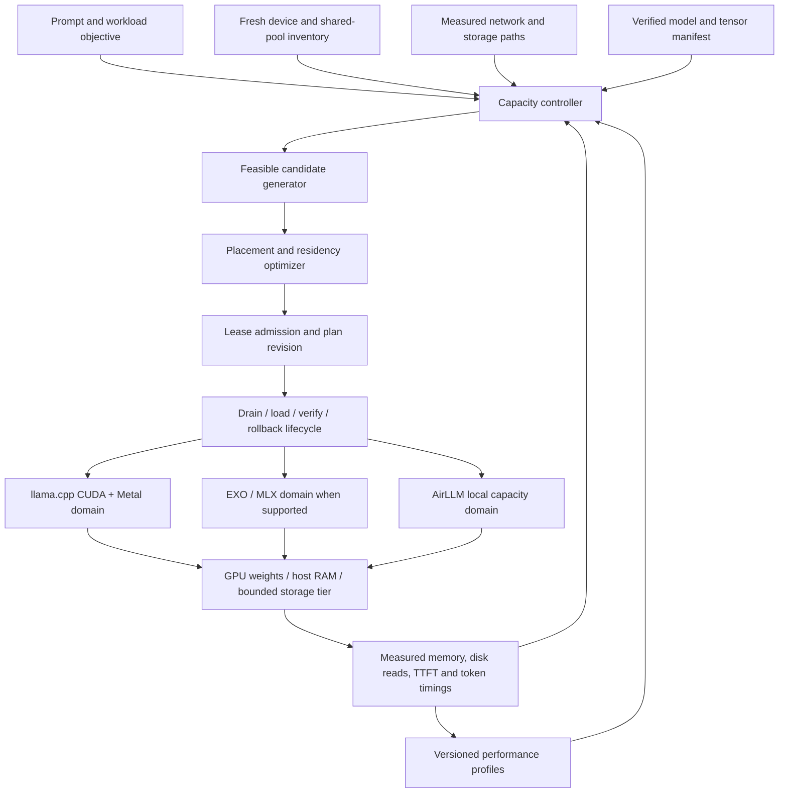

# Hypercompute: capacity first, faster as compute joins

Engineering research and proposed architecture, 21 October 2026 (America/Los_Angeles).
This document distinguishes source-verified behavior, local measurements, estimates and proposed work.
It does not claim a successful 72B run or a deployed adaptive runtime.

## Recommendation

Build a **resource-aware control layer over compatible execution backends**, with explicit memory tiers
and measured placement optimization. The first mixed Windows/Mac implementation should extend the
already working llama.cpp CUDA/Metal path. AirLLM contributes the bounded layer-loading approach;
EXO/MLX contributes distributed placement and execution techniques. Their complete-model HTTP APIs
cannot be chained together to share arbitrary layers of one inference.

The product promise is: **a model can continue at lower speed when memory is scarce, and can move to
a faster placement when more resources become available.** Capacity remains constrained by storage,
the largest executable operation, live KV state, workspaces and supported model/backend combinations.
Offload changes where bytes reside; it does not remove these constraints.

For the hackathon, prove two independent things with the same model and quantization:

1. Two laptops generate correctly while the configured resident weight allowance is below the model's
   weight footprint, with measured paging/streaming and bounded memory pressure.
2. Adding two M4 Airs causes an automatic, safe replan/reload that reduces disk reads per generated
   token and improves measured time to first token and/or decode latency.

Use a small existing model to validate the mechanism before a 72B download. A planning budget alone
does not prove that the OS actually paged or that the runtime enforced its memory bound.

## Research map

Read these source-linked audits for implementation details, immutable commits and license checks:

| Area | Audit | What to extract |
| --- | --- | --- |
| llama.cpp, ggml, related capacity runtimes | [llama audit](hybrid-llama-audit.md) | CUDA/Metal executor, RPC ownership, mmap behavior, layer scheduling, PRIMA and expert-cache limits |
| AirLLM, Accelerate, FlexLLMGen, KTransformers | [offload audit](hybrid-offload-audit.md) | Onload/offload hooks, largest-layer reservation, separate weight/KV/activation budgets, overlapping transfers |
| EXO, MLX, MLX-LM | [EXO/MLX audit](hybrid-exo-mlx-audit.md) | Placement, pipeline/tensor execution, cache ownership, selective downloads, actual transport/platform limits |
| Petals, Distributed Llama | [routing audit](hybrid-routing-audit.md) | Measured route costs, KV recovery, tensor synchronization and failure handling |

The useful distinctions are resident weights versus upload cache; weights versus KV cache; dense
transformers versus sparse MoE; batch-one decode latency versus batched throughput; and source support
versus a hardware-verified deployment. A README speedup is not a prediction for these laptops.

## What is already true locally

The source baseline for this study is Hypercompute `f21c42f`. The live Iroh gateway still runs `890f798`.

| Capability | Current evidence |
| --- | --- |
| Windows CUDA plus physical M4 Metal execution | Verified with Qwen 0.5B and Qwen 32B through Iroh RPC |
| Qwen 32B Q4_K_M resident host-RAM tier | Two uncached correct streamed probes; 1.60–1.73 s TTFT and 5.03–5.35 engine tokens/s; 1024 context |
| Actual 32B placement | CPU 28 layers, Mac 1 layer, CUDA 35 layers plus output head; not a balanced speed benchmark |
| Safe 32B Windows loading policy | Resident-only `none/no-host/no-repack` succeeded; minimum sampled free RAM 5.033 GiB during final loading/inference |
| 72B | Official artifacts and header-based plan inspected; no full download or inference |
| Automatic join-triggered redistribution | Absent; current placements remain fixed until a new deployment |
| Cross-engine tensor/KV sharing | Absent; one adapter owns each deployment |

The short 32B probes establish correctness, not stable sustained speed. Its host application reserve
was set to 4 GiB for that controlled trial; the Mac retained its 4 GiB reserve and 10 GiB contribution cap.
The current relay transferred weights at roughly 1 MiB/s. These observations are hardware-specific.

The current two-machine 72B Q3 header-based forecast selects 50 CPU layers with about 19.79 GiB of
file-backed weights, seven Mac layers and 23 CUDA layers plus output. This is an admission estimate,
not proof of an acceptable Windows paging implementation. An initial 32B disk-tier attempt was stopped
for memory pressure; the cause of every stalled operation was not isolated.

Three 16 GB M4 Airs plus the Windows laptop make a larger resident placement plausible. They do not
guarantee a particular speedup or a resident Q4 fit. Their actual contribution budgets and network
measurements must drive the plan. Current host SSD space is only about 5.7 GiB; official 72B Q3 weights
need 33.04 GiB, plus the downloader's existing 2 GiB reserve. Storage is separate from execution capacity.

## Current code boundaries and gaps

- [`selector.choose_plan`](../../backend/hypercompute/services/selector.py) selects one complete engine.
  The llama path already tries GPU, host RAM and file-backed CPU paging. AirLLM uses an HF variant
  when available, rather than consuming a GGUF tensor stream from llama.cpp.
- [`planner.ram_tier_layout`](../../backend/hypercompute/services/planner.py) chooses CPU-prefix and GPU
  suffix spans. Its paging estimate charges workspace/KV but not all CPU weights as resident. Its
  performance priors do not measure sustained disk faults or present relay behavior.
- [`DeploymentManager`](../../backend/hypercompute/services/deployments.py) snapshots a plan at creation,
  allows one active deployment, and stops affected deployments on peer loss. Node joins do not trigger
  replacement planning. This is the insertion point for a transactional replan controller.
- [`ProfileStore`](../../backend/hypercompute/services/profiles.py) and
  [`Tuner`](../../backend/hypercompute/services/tuner.py) already preserve measured results and compare
  a few candidates. Extend these rather than create a competing profile database.
- [`AirLLM adapter`](../../backend/hypercompute/adapters/airllm.py) is a local capacity engine. Adding
  Macs does not change an AirLLM deployment's layer placement.
- [`EXO adapter`](../../backend/hypercompute/adapters/exo.py) implements a real external MLX deployment
  lifecycle. Hypercompute currently advertises it for Mac workers through a direct endpoint; the
  Iroh join path does not transport an EXO cluster. Upstream MLX/EXO Linux-CUDA code must be considered
  separately from this adapter and from native Windows execution.

## Proposed architecture



The boxes below the lifecycle are alternative compatible execution domains, not three pieces of one
currently interoperable graph. The shared control layer owns admission, manifests, objectives, profiles,
replanning and evidence. Each executor owns kernels, weight representation, KV format and synchronization.

### Resource model

Track allocation pools, not just devices. Mac CPU and Metal share one physical pool; do not add their
reported free memory together. Windows CPU RAM, discrete VRAM, pageable commit and the SSD are different
resources. A weight lease must include peak staging requirements as well as steady-state residency.

For each pool, require:

`weights_resident + KV + workspace + staging + safety <= fresh_free - user_reserve - other_leases`

For a layer-streaming backend, reserve at least the largest executable layer or tensor group plus its
workspace and KV. Double-buffer prefetch is allowed only when two staging slots fit. Otherwise use one
slot and accept serial load/compute. Account for dtype conversion, dequantization and repacking peaks.
The CPU source buffer and GPU destination may coexist during transfer.

For Qwen2.5-72B, standard fp16 K/V at batch one consumes
`80 * 2 * 8 * 128 * context * 2` bytes. At 1024 positions this is 320 MiB before allocator/workspace
overhead. KV quantization, sliding windows and cache layout are backend-specific capabilities, not
universal assumptions. Growing context is an allocation event, not a free operation.

Telemetry needs age, confidence and provenance. Sample available physical RAM, actual engine buffers,
working set, private commit, hard-fault I/O, per-device use, temperature/power state and link tails.
Do not substitute Windows private commit for resident memory. Current gateway disk inventory was stale;
download/admission must refresh actual volume space immediately before allocation.

### Model and representation manifest

Pin model revision and every weight shard hash. Record tokenizer/chat template, architecture, tensor
shapes, quantization blocks, per-layer bytes, embedding/output ownership, RoPE settings, attention
layout, backend build and KV dtype. Plan on actual unequal layer sizes; total parameters alone cannot
determine a valid split.

A GGUF Q3 model and an MLX or HF variant are distinct execution artifacts. Switching between them
requires explicit compatibility and quality validation. Do not silently change quantization during a
two-versus-four-machine comparison and label the result a hardware speedup.

### Placement objective

For one autoregressive stream with a layer pipeline:

`T_decode = sum(stage_compute + exposed_weight_IO + boundary_transfer + synchronization)`

The sum is required: the next token depends on the previous token and each stage depends on the
preceding stage. `max(stage_time)` describes a filled microbatch pipeline's throughput, not this latency.
Tensor parallelism has a different cost: concurrent shard computation plus repeated collectives.
Choose it only through a backend that supports it, with measurements of the actual link topology.

Score a candidate for the user's workload:

`J = missing_weight_load + setup + prefill(prompt_tokens) + expected_output_tokens * T_decode + risk_margin`

For an already warm service, omit weight loads already paid. For a proposed replacement, add reload,
warmup and any KV reconstruction. Compare median and tail estimates; a slightly faster plan with frequent
disconnects may be unsuitable. A latency objective and a many-user throughput objective require different
batch/concurrency models.

Use measured per-stage coefficients for the same model family, quantization, kernel, context, batch and
power state. Advertised memory bandwidth is only an initial bound. Test the top few candidates briefly
and save a measured profile. Profile identity must include artifact hash, backend build, KV dtype,
devices, pool budgets, topology/path class and relevant engine flags. Expire profiles when these change.

### Resident cache and paging policy

Separate three caches:

1. **Persistent weight download/upload cache:** reduces startup transfers; does not reduce GPU memory
   needed by live weights or automatically improve token generation.
2. **Explicit resident weight set:** avoids repeated storage or PCIe transfers during generation.
3. **KV/prefix cache:** avoids attention recomputation; has its own request and revision lifetime.

Dense Qwen uses every transformer layer for every decoded token. A naive LRU cache smaller than a full
cyclic layer scan can miss on nearly every layer. Do not model SSD reads as only the excess bytes unless
the implementation actually retains a fixed subset. OS file cache may satisfy reads without SSD I/O,
and is not bounded by a planner's accounting. Measure actual hard-fault/disk bytes per token.

A proposed managed worker should keep a selected resident subset and stream the rest with a bounded
lookahead. Original interface sketch:

```python
lease = pools.reserve(weights=hot_bytes, kv=kv_bytes, workspace=workspace, staging=slot_bytes)
try:
    for layer in assigned_layers:
        handle = await weights.acquire(layer, revision=plan_revision)  # resident or bounded onload
        await executor.run_layer(handle, request.kv_for(layer), activations)
        await weights.release_after(handle, executor.completion_event())
        weights.prefetch_if_room(next_layer)  # no unbounded queue; admission before allocation
finally:
    await executor.drain_or_cancel()
    lease.release()
```

This is an implementation contract, not a new callable API in the current repo. GPU completion must
precede reuse of a staging slot. Validate cache key, checksum, tensor shape and epoch at acquisition.
Cancellation must prevent queued prefetch from resurrecting freed allocations.

### Adaptive controller: safe replan/reload first

Use the lifecycle `observe -> candidate -> admit -> drain -> reload -> verify -> active`, with explicit
`rollback` and `failed` paths. A join is a reason to evaluate, not an instruction to use every device.

Original policy sketch:

```python
if topology_or_capacity_changed():
    snapshot = inventory.fresh_snapshot()
    candidate = optimizer.best_admissible(snapshot, current_model, workload)
    if candidate.is_executable and candidate.savings_over_horizon > candidate.reload_and_replay_cost:
        if measurements_stable() and improvement_exceeds_hysteresis():
            await requests.drain_current_request()
            await deployments.replace_transactionally(candidate, previous_plan=current_plan)
```

Start with request-boundary replacement. It is reload, not live migration. Retain the conversation and
sampling configuration; a new deployment recomputes prefix KV as needed. Do not promise bit-identical
output across kernels or quants. If a worker disappears during generation, report the interruption and
resume only with an explicit replay protocol that avoids duplicate displayed tokens.

Every plan has a monotonically increasing revision and exclusive pool leases. Revalidate before load;
the inventory snapshot can become stale while a large transfer is in flight. The replacement transaction
must coordinate the existing one-active-deployment guard and release old leases only after cleanup.
If the old devices are gone, rollback may be impossible: compute another feasible capacity plan or
report the real failure. Never describe a stale previous plan as a guaranteed recovery path.

Memory-pressure handling is separate from speed optimization. Stop new admissions first, cancel
prefetch, reduce allowed concurrency/context for future requests, then reload to a feasible tier. A user
request must not silently lose context or precision. Preserve contributor reserves and explicit limits.

Cross-engine live KV migration is a later research project: cache layout, key rotation, position indices,
attention windows, quantization, block packing and model variants all have to match. EXO's remote-prefill
KV transfer is relevant code, but not a ready ggml-to-MLX cache converter.

## Executable planning prototype

[`experiments/capacity_optimizer.py`](../../experiments/capacity_optimizer.py) is an offline, standard-library
reference implementation. It starts no engine, performs no allocation on a GPU, downloads nothing and
never changes a live deployment. It searches CPU-prefix, optional contiguous peer spans and a local-GPU
suffix/output head using dynamic programming, enumerating peer orders for up to four peers.

It accounts for unequal layer sizes, embeddings, head, KV and workspace; rejects double-counted UMA
pools; permits CPU paging only when requested; distinguishes OS scan misses from a proposed fixed
resident subset; and scores steady decode or cold upload plus a generation horizon. A pure controller
function applies reload break-even, stability samples and hysteresis.

It is an exact search **only within this restricted topology and supplied additive cost model**.
It omits prefill, contention, kernel overhead, thermals and live KV reconstruction. It is not the globally
best plan over all kernels, tensor splits or runtimes. Its report explicitly cannot be applied as a
deployment. Production integration needs all admission and executor checks above.

```powershell
uv run python experiments/capacity_optimizer.py experiments/capacity_scenarios.json
uv run python -m unittest discover -s experiments -p test_capacity_optimizer.py -v
```

The scenario fixture preserves the official Q3 aggregate tensor size and embedding/head bytes, but
uses **uniform illustrative layer sizes**, assumed device rates and assumed future Mac allowances.
The generated [scenario output](../../experiments/capacity_scenarios.output.json) is not a benchmark.
Its useful results are qualitative: more resident capacity can remove steady disk reads; cold relay
uploads can outweigh that benefit for a short request; and an available slow peer can be skipped.
Replace all assumptions with per-layer metadata and calibrated profiles before making speed claims.

## Decision record

**ADR-HC-001 — proposed, pending physical capacity validation.** Use one control layer and compatible
execution domains; deliver mixed-device capacity through llama.cpp first, with a bounded memory policy
and automatic request-boundary replan/reload. Keep EXO/MLX as a separately calibrated domain and AirLLM
as a local capacity backend/reference for streaming behavior.

Alternatives considered:

- **Only combine whole-model APIs:** useful engine routing, but cannot give an AirLLM request extra
  Macs or share one model's tensors. It does not fulfill adaptive distributed capacity by itself.
- **Immediately bridge arbitrary llama.cpp, PyTorch and MLX layer objects:** maximum flexibility but
  introduces weight-format, kernel, activation and KV compatibility work before a reliable demo.
- **Use upstream EXO/MLX for every machine:** interesting because current source includes Linux CUDA
  paths, but native Windows, the current adapter, the Iroh connection path and capacity streaming still
  need separate proof. A Linux/WSL pilot is an alternative track, not evidence of present compatibility.
- **Adopt a complete adjacent distributed runtime:** PRIMA and Distributed Llama offer valuable
  scheduling designs, but their platform/network/weight-format assumptions must be validated here.

Consequences: fast reuse of the working executor and existing deployment manager; honest backend
boundaries; deliberate reload interruptions at request boundaries; no initial promise of live migration;
and native runtime work to obtain genuinely controlled paging/streaming rather than a soft planner estimate.

## Implementation sequence and acceptance gates

| Step | Concrete work | Gate before moving on |
| --- | --- | --- |
| 1. Truthful telemetry | Fresh pool/storage snapshots; distinguish RSS, commit, cache and leases; log actual weight/KV placement | Recorded buffers and physical observations agree within explained overhead |
| 2. Capacity canary | Existing small GGUF, isolated child, stock mmap versus opt-in no-prefetch and managed loading experiments | Correct output; observed residency and actual I/O; cancellation and cleanup; no global cache flush |
| 3. Runtime memory policy | Explicit staging/prefetch bounds and fixed-resident policy where needed; retain file backing for oversized CPU weights | Measured bounded peak including load, conversion, KV and compute; fault-injection cleanup |
| 4. Planner overlay | Per-layer metadata, measured phase costs, shared-pool constraints, missing-weight startup cost | Predicted versus observed top-candidate ranking; invalid plans rejected |
| 5. Automatic replacement | Stable join/leave/resource trigger, drain/reload, revisioned leases, rollback/replan | New Mac reduces measured disk reads or latency; slow Mac skipped; pressure/loss handled clearly |
| 6. 72B two-versus-four demo | Same Q3 artifact, same context/prompts/output length, direct/relay path recorded | Correctness, participation, comparable timings and memory/I/O evidence; no unreported failed repetitions |
| 7. Alternative backend pilot | EXO/MLX Linux-CUDA/Metal or managed MLX paging, in isolation | Supported model and topology verified before integration into selection |

Windows no-prefetch is an experiment, not a complete capacity fix. `PrefetchVirtualMemory` fills the
reclaimable physical cache, not the process working set directly. Removing it may reduce loading
pressure, but does not enforce a RAM ceiling. `--load-mode none` allocates CPU weights and therefore
must not be used as the capacity fallback when those weights exceed the available resident budget.

For the physical benchmark, report loading separately from warm inference; separate uncached prompt
processing from prefix reuse; use at least three measured repetitions after warmup and a meaningful
decode length; retain failures; use actual engine tokens rather than SSE chunk counts. Record median
and tail TTFT, decode time, SSD read bytes/token, private/RSS memory, actual GPU/KV allocations,
network bytes, power/thermal state and the observed direct/relay path.

For scientific claims about speedup, compare the same artifact and workload. Report
`two_machine_decode_time / four_machine_decode_time` only after measuring both. A cost-model estimate,
an upstream benchmark on different hardware, and the 32B correctness probes are not that measurement.

## Operational boundaries

Keep the authenticated contributor and fixed-destination transport model. New tensor/cache protocols
need authenticated model identities, bounds on sizes and allocations, cancellation epochs and checksum
validation; do not expose raw engine RPC publicly. A contributor processes activations and may receive
model data, so the existing sharing/consent boundary remains relevant.

No research step in this package restarts the live host, changes contributor limits, deletes model files,
installs large dependencies or claims successful 72B inference. The serving 32B process remains the
working baseline while the capacity architecture is developed.
