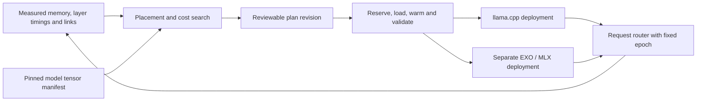

# EXO, MLX and MLX-LM: evidence for a heterogeneous placement controller

Reviewed 2026-10-22 UTC. Scope: source and primary documentation, with small selected source downloads; no engine installation, inference, service restart, hardware configuration or model download. The running Qwen 32B session was left alone. **Verified** means inspected code/documentation, **inferred** means a consequence that needs a physical test, and **proposed** describes new work rather than an existing feature.

The immediate engineering choice is a placement controller above the existing llama.cpp execution path, with an independent EXO/MLX experiment on the Macs. Three M4 Airs add usable memory and can execute real transformer work, but their arrival does not rebalance a running model. EXO provides useful topology, sharding, chunked prefill and cache primitives; it is not already a controller that dynamically moves a live Windows llama.cpp model into MLX workers.

## Reproducible source set

| Project | Reviewed revision | License | Boundary |
|---|---|---|---|
| [EXO](https://github.com/exo-explore/exo) | `bc412e2230f395e652c23426a5eb88dfa515769b` | [Apache-2.0](https://github.com/exo-explore/exo/blob/bc412e2230f395e652c23426a5eb88dfa515769b/LICENSE) | Orchestration, placement, MLX runners and transports; source version 0.3.70 |
| [MLX](https://github.com/ml-explore/mlx) | `52a6c234ab35ddf46c8bd1517b849b59b610d078` | [MIT](https://github.com/ml-explore/mlx/blob/52a6c234ab35ddf46c8bd1517b849b59b610d078/LICENSE) | Array execution, allocators and distributed operations |
| [MLX-LM](https://github.com/ml-explore/mlx-lm) | `72be8c955d9a0d3099bd01865af288e0e947c3fa` | [MIT](https://github.com/ml-explore/mlx-lm/blob/72be8c955d9a0d3099bd01865af288e0e947c3fa/LICENSE) | Model loading, quantization, Qwen layers and KV cache |

The three revisions were resolved from GitHub during this audit. **Canonical MLX/MLX-LM above are comparison targets, not EXO's exact dependency graph.** EXO locks macOS MLX to `0e3ff3643b1c3719f78814b98e0d222afbad867c` and an MLX-LM fork to `6a3df6cd6b00a347ee40f12d97a182aaf86ea599` on `rltakashige/mlx-lm`'s `leo/deepseek-v4` branch. Replacing them with current upstream without compatibility testing would invalidate this pin. [EXO dependency declarations](https://github.com/exo-explore/exo/blob/bc412e2230f395e652c23426a5eb88dfa515769b/pyproject.toml#L81-L97), [MLX lock](https://github.com/exo-explore/exo/blob/bc412e2230f395e652c23426a5eb88dfa515769b/uv.lock#L1430-L1432), [MLX-LM lock](https://github.com/exo-explore/exo/blob/bc412e2230f395e652c23426a5eb88dfa515769b/uv.lock#L1547-L1549).

License reuse boundaries: retain copyright and MIT notices when adapting Apple code; preserve EXO's Apache license/notice obligations for copied code and document modifications. Model licenses are separate from engine licenses. The proposed controller interfaces below are original design sketches, not copied implementations.

## What these laptops can actually use

The relevant M4 Air specification is **120 GB/s local unified-memory bandwidth, 16 GB configured memory, two Thunderbolt 4 ports rated up to 40 Gb/s, and Wi-Fi 6E**. Those port ratings are not application throughput. [Apple's model-specific M4 Air specifications](https://support.apple.com/en-us/122209).

MLX's JACCL RDMA implementation requires Thunderbolt 5 and macOS SDK 26.2 or later. The M4 Air's Thunderbolt 4 cannot acquire that hardware capability through an OS update. The applicable Mac-to-Mac path is TCP over Ethernet, Wi-Fi or an explicitly configured Thunderbolt IP ring. MLX ring supports neighbor send/receive and collective operations; arbitrary rank-to-rank sends are unsupported. [JACCL requirements](https://github.com/ml-explore/mlx/blob/52a6c234ab35ddf46c8bd1517b849b59b610d078/mlx/distributed/jaccl/lib/README.md#L1-L41), [TCP ring constraints/setup](https://github.com/ml-explore/mlx/blob/52a6c234ab35ddf46c8bd1517b849b59b610d078/docs/src/usage/distributed.rst#L128-L193).

Do not transfer benchmarks from Thunderbolt 5 Mac Studio clusters to these Airs. Also avoid assuming JACCL is mesh-only: this revision's library supports both mesh and ring topology, although the user guide emphasizes meshes. Neither variant makes JACCL available on Thunderbolt 4. [Current JACCL topology configuration](https://github.com/ml-explore/mlx/blob/52a6c234ab35ddf46c8bd1517b849b59b610d078/mlx/distributed/jaccl/lib/README.md#L98-L124).

**Mixed CUDA/Metal needs precise wording.** MLX now has a Linux CUDA backend and NCCL. EXO declares Linux CUDA 12/13 extras and detects NVIDIA devices through NVML; its `MlxRing` placement allows Metal, CUDA and CPU backends. This is implemented backend routing, not merely a roadmap. However, this audit did not validate an actual mixed Linux-CUDA/Metal run, native Windows execution, or a compatible CUDA wheel for this RTX laptop. NCCL itself operates on CUDA buffers and is not the Metal bridge. [EXO CUDA packages](https://github.com/exo-explore/exo/blob/bc412e2230f395e652c23426a5eb88dfa515769b/pyproject.toml#L62-L94), [backend discovery](https://github.com/exo-explore/exo/blob/bc412e2230f395e652c23426a5eb88dfa515769b/src/exo/utils/info_gatherer/info_gatherer.py#L357-L383), [allowed ring backends](https://github.com/exo-explore/exo/blob/bc412e2230f395e652c23426a5eb88dfa515769b/src/exo/master/placement.py#L66-L68), [NCCL CUDA execution](https://github.com/ml-explore/mlx/blob/52a6c234ab35ddf46c8bd1517b849b59b610d078/mlx/distributed/nccl/nccl.cpp#L310-L364).

Hypercompute's current EXO adapter selects macOS ARM64 workers and controls EXO through HTTP; Windows can coordinate without executing an EXO shard. The Iroh path intentionally exposes only the authenticated llama RPC service: `cli.py:_run_peer_join` rejects EXO with a ticket and `services/nodes.py` strips advertised extra engines for Iroh nodes. Consequently, existing Iroh reachability does not establish EXO's peer discovery or inter-rank data paths. See local `backend/hypercompute/adapters/exo.py:159-212`, `backend/hypercompute/cli.py:258`, and `backend/hypercompute/services/nodes.py`.

## EXO placement: useful baseline, incomplete objective

The following steps are verified in `place_instance`, rather than inferred from the dashboard:

| Step | Actual policy | Consequence for our overlay |
|---|---|---|
| Enumerate topology | Simple connected cycles plus singleton candidates | Keep explicit topology constraints; do not equate four online machines with four mutually reachable ranks. |
| Account pending work | Deduct weight estimates for runners that are starting/loading | Reuse reservation-before-load semantics to avoid concurrent overcommit. |
| Memory admission | Sum reported available RAM against model storage size | Replace weight-only admission with weights + KV + activations + runtime + loading peak + user reserve. |
| Tensor eligibility | Model support, hidden-size and KV-head divisibility | Retain architecture-specific constraints; three-way tensor parallel Qwen with eight KV heads is not automatically valid. |
| Choose participants | Smallest fitting cycles; prefer cycles containing leaf nodes, then downloaded fractions, then available RAM | This is not a latency or compute-availability optimizer. |
| Pipeline split | Proportional to free memory, rounded by largest remainder, at least one layer per rank | Use as a capacity baseline; measure layer time and choose deliberately unequal splits on heterogeneous machines. |

Sources: [cycle enumeration](https://github.com/exo-explore/exo/blob/bc412e2230f395e652c23426a5eb88dfa515769b/src/exo/shared/topology.py#L214-L224), [pending memory](https://github.com/exo-explore/exo/blob/bc412e2230f395e652c23426a5eb88dfa515769b/src/exo/master/placement.py#L151-L188), [candidate filtering and scoring](https://github.com/exo-explore/exo/blob/bc412e2230f395e652c23426a5eb88dfa515769b/src/exo/master/placement.py#L210-L358), [memory checks and proportional layer assignment](https://github.com/exo-explore/exo/blob/bc412e2230f395e652c23426a5eb88dfa515769b/src/exo/master/placement_utils.py#L21-L122).

EXO reports GPU utilization, temperature and power, but the inspected placement function does not consume those metrics to optimize the split. `SystemPerformanceProfile` even retains a FLOPS TODO; network placement input is interface information, not measured transfer curves. A low GPU utilization reading alone is also not a layer-throughput measurement. [Profiling schema](https://github.com/exo-explore/exo/blob/bc412e2230f395e652c23426a5eb88dfa515769b/src/exo/shared/types/profiling.py#L13-L91).

There is a useful search limitation to preserve explicitly: EXO chooses smallest fitting cycles before the final backend filtering. Our controller should enumerate *valid* candidates before optimizing their size/cost, and retain rejection reasons for review. Exhaustive simple-cycle enumeration is acceptable for four laptops; it is not a scalable large-cluster placement algorithm.

## Execution, formats and where the KV cache lives

EXO lazy-loads the model, slices the layer list to the assigned contiguous range, evaluates those layers, and wraps stage boundaries with receive/send operations. `mx.eval(model.parameters())` then materializes retained parameters. This is resident shard loading, not a bounded disk-to-GPU sliding weight window. Its runtime patches ensure distributed operations remain dependencies of cached state. [Shard loader](https://github.com/exo-explore/exo/blob/bc412e2230f395e652c23426a5eb88dfa515769b/src/exo/worker/engines/mlx/utils_mlx.py#L233-L279), [stage construction](https://github.com/exo-explore/exo/blob/bc412e2230f395e652c23426a5eb88dfa515769b/src/exo/worker/engines/mlx/auto_parallel.py#L276-L309), [boundary operations](https://github.com/exo-explore/exo/blob/bc412e2230f395e652c23426a5eb88dfa515769b/src/exo/worker/engines/mlx/auto_parallel.py#L120-L194).

EXO does implement overlapping **prefill** stages: prompt chunks are staggered across ranks, with leading/trailing dummy work, and queued sends. This can improve prompt throughput when compute outweighs communication. A single autoregressive decode token still traverses stages sequentially. Its latency objective is approximately `sum(stage_compute + boundary_transfer + synchronization)`; `max(stage_time)` is the steady-state throughput bound for a sufficiently populated pipeline, not the batch-one decode latency. [Implemented prefill schedule](https://github.com/exo-explore/exo/blob/bc412e2230f395e652c23426a5eb88dfa515769b/src/exo/worker/engines/mlx/generator/generate.py#L163-L276).

Canonical MLX-LM provides another useful reference implementation: `PipelineMixin` accepts explicit layer counts, while Qwen2 receives hidden states, computes local layers with local caches, forwards hidden states, then gathers the final hidden state. Tensor sharding splits attention/MLP projections and adds collective communication; it is real parallel compute, with much tighter network requirements. [Pipeline split](https://github.com/ml-explore/mlx-lm/blob/72be8c955d9a0d3099bd01865af288e0e947c3fa/mlx_lm/models/pipeline.py#L4-L38), [Qwen pipeline](https://github.com/ml-explore/mlx-lm/blob/72be8c955d9a0d3099bd01865af288e0e947c3fa/mlx_lm/models/qwen2.py#L138-L173), [Qwen tensor sharding](https://github.com/ml-explore/mlx-lm/blob/72be8c955d9a0d3099bd01865af288e0e947c3fa/mlx_lm/models/qwen2.py#L206-L239).

The model format boundary matters: MLX-LM loads configuration/tokenizer metadata and `model*.safetensors`, applying MLX quantization layouts. Existing Qwen GGUF Q3/Q4 shards cannot simply be passed to this loader. MLX and GGUF quantization names or bit counts do not guarantee numerically identical weights. Use the same source model revision and documented conversion recipe when comparing engines. [Loader and quantization](https://github.com/ml-explore/mlx-lm/blob/72be8c955d9a0d3099bd01865af288e0e947c3fa/mlx_lm/utils.py#L409-L599).

EXO currently downloads the complete model repository on each participating node (`resolve_allow_patterns` returns `['*']`). In contrast, canonical MLX-LM `sharded_load` uses the safetensors index to fetch files containing local layers plus files holding embeddings, final norm and head. Every pipeline stage retains those non-layer weights; this duplication must enter our capacity estimate. File-granularity downloads may also fetch tensors outside the owned layer range. This upstream loader is a useful storage optimization reference, not already integrated in EXO. [EXO download policy](https://github.com/exo-explore/exo/blob/bc412e2230f395e652c23426a5eb88dfa515769b/src/exo/download/download_utils.py#L845-L857), [MLX-LM selective download and retained parameters](https://github.com/ml-explore/mlx-lm/blob/72be8c955d9a0d3099bd01865af288e0e947c3fa/mlx_lm/utils.py#L709-L812).

KV state belongs to the rank that computes its layers. MLX-LM constructs per-layer cache objects and can serialize their state, class names and metadata to safetensors. EXO's prefix cache keeps matching request entries across ranks but different local tensor contents; all ranks coordinate eviction if any rank exceeds its budget or memory-pressure threshold. Prefix-cache eviction is not model-weight paging. [Cache creation and persistence](https://github.com/ml-explore/mlx-lm/blob/72be8c955d9a0d3099bd01865af288e0e947c3fa/mlx_lm/models/cache.py#L15-L112), [EXO coordinated eviction](https://github.com/exo-explore/exo/blob/bc412e2230f395e652c23426a5eb88dfa515769b/src/exo/worker/engines/mlx/cache.py#L446-L493).

There **is** an implemented remote-prefill transfer primitive: a framed protocol carries request/model identity, dtype, layer index, head dimensions, positions and KV bytes; the MLX client imports them into caches, and generation can fall back to local prefill. Do not describe EXO as lacking all KV transfer. What is missing from the inspected placement/lifecycle path is automatic, atomic migration of an existing decode session to a different shard assignment. The inspected import loop indexes rank-local cache lists; a future arbitrary reshard needs explicit global-layer/head-range mappings, revision checks and completeness validation. No llama.cpp-to-MLX KV conversion was found in these paths. [Wire schema](https://github.com/exo-explore/exo/blob/bc412e2230f395e652c23426a5eb88dfa515769b/src/exo/worker/disaggregated/protocol.py#L12-L54), [MLX importer](https://github.com/exo-explore/exo/blob/bc412e2230f395e652c23426a5eb88dfa515769b/src/exo/worker/engines/mlx/disaggregated/client.py#L106-L147), [remote-prefill selection/fallback](https://github.com/exo-explore/exo/blob/bc412e2230f395e652c23426a5eb88dfa515769b/src/exo/worker/engines/mlx/generator/generate.py#L642-L668).

## Reconfiguration and out-of-core hooks

Topology discovery updates membership; existing instances retain their explicit runner/shard map. If a node disappears, the master deletes affected instances. This is failure detection, not elastic KV migration. New Macs can support a **new** placement after admission; a safe first controller drains existing requests and reloads before switching the routing epoch. [Missing-node instance deletion](https://github.com/exo-explore/exo/blob/bc412e2230f395e652c23426a5eb88dfa515769b/src/exo/master/main.py#L620-L653).

Discovery uses the EXO networking service and namespace matching; the existing pinned-source audit in `docs/research/exo.md` records the LAN multicast/Zenoh/API port requirements. Namespace comparison is not cryptographic authorization. Reusing our authenticated Iroh transport for EXO would require explicit service multiplexing and peer membership enforcement; forwarding arbitrary local TCP destinations is not an acceptable shortcut. [Discovery namespace check](https://github.com/exo-explore/exo/blob/bc412e2230f395e652c23426a5eb88dfa515769b/rust/networking/src/discovery.rs#L210-L225).

MLX exposes allocation, reuse-cache and wired-memory limits. The Metal allocator tracks active plus cached buffers and reclaims reusable buffers under pressure. Increasing a limit does not add physical memory or implement a weight eviction schedule. EXO sets the wired limit to the device's recommended working-set maximum and warns about large weights; this is not equivalent to honoring Hypercompute's per-user 4 GiB reserve. [Metal allocator](https://github.com/ml-explore/mlx/blob/52a6c234ab35ddf46c8bd1517b849b59b610d078/mlx/backend/metal/allocator.cpp#L58-L180), [EXO working-set setting](https://github.com/exo-explore/exo/blob/bc412e2230f395e652c23426a5eb88dfa515769b/src/exo/worker/engines/mlx/utils_mlx.py#L797-L819).

The smallest useful MLX out-of-core experiment is a **single Mac, small dense model, explicit two-layer weight window**: retain KV, prefetch the next layer from a pinned local artifact, materialize the current layer, synchronize its work, release references to completed weights, and measure the allocator's active/cache peaks. Lazy evaluation makes lifetime correctness essential: releasing Python names before dependent GPU work is complete does not prove memory was freed. Success criteria must include bounded physical footprint and measured disk bytes/token, not merely an inference that finishes because macOS swaps. The current Hypercompute `exo_paged` capability remains a planned entry, not an implemented engine.

## Proposed controller contract and decisions

**ADR: begin with coarse stages and stable execution ownership.** Use one execution engine for each deployment. Select a llama.cpp plan for the existing Windows+Mac GGUF route, or an EXO MLX plan for a separately validated MLX cluster. A mixed-engine stage pipeline requires a new activation protocol, numerically compatible model artifacts, positional conventions, KV schema and error/cancellation handling. It is a research track, not a selector flag.

**ADR: optimize two explicit objectives.** For interactive batch-one decode, minimize end-to-end token latency subject to memory and reserve constraints. For prefill or concurrent requests, minimize the bottleneck stage and pipeline bubbles. Penalize loading/migration time and uncertainty. Idle compute may be useful without extra memory, while extra memory on a very slow node may improve fit but worsen latency. The planner must expose both outcomes.

**ADR: reconfigure between requests first.** A node join updates candidates and triggers a proposal; it does not mutate an active runner. Use hysteresis and a minimum predicted improvement to avoid repeated reloads. Losing a required node fails the current execution epoch clearly. Preserve token history so a later plan can re-prefill; cache migration comes only after checkpoint correctness tests.



Original interface sketch; this document does not implement it:

```python
@dataclass(frozen=True)
class StageLease:
    model_digest: str       # weights + quantization + tokenizer + RoPE/config
    plan_epoch: int
    node_id: str
    global_layers: tuple[int, int]
    backend: str            # llama_rpc or mlx; never inferred from host OS
    resident_weight_bytes: int
    kv_reserved_bytes: int
    scratch_peak_bytes: int
    loading_peak_bytes: int
    reserve_bytes: int

class StageWorker(Protocol):
    async def prepare(self, lease: StageLease) -> Prepared: ...
    async def run(self, request_id, epoch, token_positions, hidden) -> Hidden: ...
    async def drain(self, epoch) -> Checkpoint: ...
    async def release(self, epoch) -> None: ...

def propose(snapshot, manifest, objective, current_plan):
    candidates = enumerate_valid_topologies_and_contiguous_splits(snapshot)
    candidates = [p for p in candidates if fits_with_all_peaks_and_reserves(p)]
    # Decode=sum(stage costs); steady microbatch throughput uses max(stage).
    scored = [(estimate_phases(p, measured_profiles=True), p) for p in candidates]
    return choose_with_reload_cost_uncertainty_and_hysteresis(scored, current_plan)
```

Future cache checkpoints need a schema version, model digest, exact global layer/head ranges, tensor layout/dtype, RoPE parameters, token positions, accepted-token count and integrity hashes. A new epoch becomes routable only after every required stage validates a complete checkpoint. Keep old ownership until the transfer commits or deliberately re-prefill from token history. Do not duplicate memory ownership implicitly: temporary copies and rollback reservations enter the admission calculation.

## Hardware-specific cost bounds and validation

For the inspected Qwen2.5-72B shape (80 layers, hidden 8192, eight KV heads of width 128), a single FP16 hidden-state boundary is **16 KiB per token**. A 1,024-token prompt is at least **16 MiB per boundary**, excluding extra collectives, envelopes and model-specific tensors. At the observed approximately 1 MiB/s relay rate, that payload alone takes 16 seconds. Full FP16 KV is `80 * 2 * 8 * 128 * 2 = 327,680` bytes/token, or **640 MiB at 2,048 tokens**; a full-cache transfer at that rate has a 10.7-minute lower bound. These are arithmetic estimates, not measured engine timings; quantized/local-layer caches differ.

The three 16 GiB Macs provide 48 GiB physical UMA, not 48 GiB deployable model storage. Current 10 GiB per-Mac contribution caps limit aggregate contribution to at most 30 GiB before model/runtime details; free memory minus each 4 GiB reserve can lower it further. Therefore a Mac-only resident 72B deployment cannot be justified from the official GGUF Q3 size of 33.036 GiB or Q4 size of 40.988 GiB, and MLX artifact sizes must be measured separately. The Windows CPU/GPU contribution is valuable in the existing llama.cpp route. The recent local disk snapshot had only 5.73 GiB free, so storage is also an admission gate. See `transport-validation/qwen72-feasibility-20261022T014723Z.json` outside the repository for the dated snapshot; no resources were freed during this audit.

Validation order, with explicit stop criteria:

1. **Offline controller checks:** exact per-tensor manifest where available; label uniform-layer approximations; test missing links, asymmetric memory, three-way head-divisibility rejection, stale metrics, pending reservations, extra embedding/head copies, and batch-one versus batched objectives. Verify that adding a slow node can increase capacity while reducing speed.
2. **Transport baseline, isolated from serving:** measure each intended direct link's useful bandwidth and latency at activation and weight-transfer sizes. Record path type, jitter and concurrent-transfer effects. Do not choose a collective-heavy plan using relay RTT alone.
3. **Small-model execution baseline:** fixed model digest, prompt and seed; compare single-Mac, two-Mac and three-Mac pipeline logits/tokens and peak physical/allocator memory. Verify every rank's owned layers and KV growth. Measure prefill and decode separately.
4. **Controlled compute changes:** background load or power-state differences under an explicit test; remeasure phase-specific layer times and propose a new split. Demonstrate request drain/reload before admitting new epoch traffic. Validate rollback when a new worker fails to load.
5. **Out-of-core prototype:** small model with forced low resident window; verify disk bytes/token, scratch/loading peaks, cancellation, cache cleanup and output equivalence. Reject a result whose apparent memory limit is achieved through uncontrolled swap.
6. **Only then 72B:** refresh all memory/disk budgets, validate the actual quantized artifact and context, stage weights on direct links or local disks, and collect TTFT/decode plus per-node telemetry. No claim of speedup until measured against the same model/context baseline.

This audit supplies source-backed building blocks and limits. It does not establish a physical EXO cluster, native Windows MLX execution, live resharding, cross-engine KV compatibility, or a 72B fit on the current free-memory snapshot.
