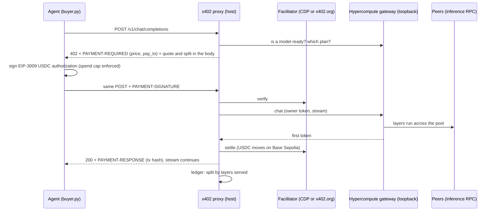

# Hypercompute x402 proxy

AI agents pay a pool of friends' computers per request, in test USDC, with x402. Every payment is split across the
machines by the model layers each one actually served.

Hypercompute pools friends' machines (an ASUS GX10, a G14 laptop, MacBook Airs) into one inference RPC pipeline that
runs 120B to 1T models no single machine could. This proxy puts that pool behind an x402 paywall. An agent sends an
ordinary OpenAI-style chat request and gets `402 Payment Required` with a price. It signs a USDC authorization and
retries, then gets the answer streamed back. The ledger credits each friend's machine by its share of the
deployment plan, and `payout.py` pays those shares out on chain.

**Testnet only.** Base Sepolia (`eip155:84532`) and Circle's test USDC, which has no value. The config refuses any
other network.

- Who it is for: people who pool spare hardware, and agents that need a big open model without an account or an API
  key. A wallet is enough.
- Track: Coinbase **Payment Agents**. One side is an agent that pays for compute, the other is a pool of machines that
  earns. Coinbase tools used: the x402 Python SDK, the CDP x402 facilitator, CDP Server Wallets (buyer, seller and
  payouts, with no private key on disk), and the CDP faucet.
- Agent platform: any MCP agent. `pool_mcp.py` gives Claude Code, Cursor and others an `ask_pool` tool that pays per
  call from a CDP wallet, under a per-call cap and a total budget the agent cannot change. `buyer.py` is the same
  buyer as a plain CLI.

## What x402 does here



The gateway's chat route is owner-only and loopback-only. The proxy runs on the host, fetches the owner token from
`GET /api/owner/bootstrap` over loopback, keeps it in memory, and never returns or logs it. Payment is the only
credential a buyer needs, and the proxy is the only surface that gets exposed.

## Settling a stream honestly

The x402 FastAPI middleware buffers the whole response before it settles, which breaks streaming. A pooled 1T model
also takes minutes to answer. So the proxy uses the SDK's framework-free `x402HTTPResourceServer` and decides when to
settle itself.

- **Streamed chat: settle at the first token.** The proxy opens the gateway stream and holds events until the first
  one with generated text. Until then nothing is submitted on chain. That covers a pool that is not ready, a busy
  pool, an upstream error, or a peer lost during prefill. Once text exists it settles, sends `PAYMENT-RESPONSE` with
  the stream headers, and streams the rest live.
- **Non-streamed chat: settle after the full reply.** Any failure means no charge.
- **Cut after settlement** (a peer lost mid-reply): the buyer gets the gateway's `interrupted` error event. The ledger
  marks the payment interrupted, records the tokens delivered, books a refund owed for the undelivered part, and
  re-splits only what was earned. Friends are never credited for tokens the buyer did not get.

Before any 402 is sent, the proxy checks that a model is ready, the model name matches, and a slot is free. A buyer
is never asked to pay for something that cannot run.

## Economics

- **Price:** `base + per_1k x max_tokens / 1000`, rounded up to the next atomic unit (USDC has 6 decimals). The
  defaults are $0.001 + $0.02 per 1k reserved tokens. They are demo values, not a cost model. `max_tokens` is capped
  (default 1024). Integer math only.
- **Why reserved tokens and not used tokens:** the x402 `exact` scheme fixes the amount when the buyer signs. The
  buyer pays for the tokens it reserves. A cut stream books the difference as a refund owed (see Known limits for
  `upto`).
- **Split:** the host takes a fee first (default 10%: it runs the gateway, embeddings and sampler). The rest is split
  by layer units, which are the same numbers the engine gets in `--tensor-split`: one per layer a machine holds plus
  one for the output head. Shares are floored and the remainder goes to the host, so they always sum to exactly the
  amount paid.
- **Payouts:** the whole payment lands in the host's `pay_to` wallet. `payout.py` sends each friend what the ledger
  says they are owed, from the host's CDP wallet, and records each transfer. The split then exists on chain, not
  only in a database.

Worked example, from the real plan of the R6 Kimi-K2.6 1T pooled run (`fixtures/kimi-k2.6-pooled-plan.json`, also
the mock gateway's plan). 48 reserved tokens cost 0.001960 USDC. The node names are the mock's labels.

| machine | layers | units | earns (USDC) |
|---|---|---|---|
| gx10 (host) | 11-60 + head | 51 | 0.001649 (includes the 0.000196 fee and a 3-unit remainder) |
| mac-azim | 0-2 | 3 | 0.000085 |
| g14 | 5-7 | 3 | 0.000085 |
| mac-b | 8-10 | 3 | 0.000085 |
| mac-a | 3-4 | 2 | 0.000056 |

`GET /x402/quote?max_tokens=N` returns this table for the live plan before anyone pays. The 402 body carries the
same table.

## Setup

Needs Python 3.11+ and [uv](https://docs.astral.sh/uv/). Everything stays in this folder.

```bash
cd integrations/x402-proxy
uv sync
cp .env.example .env
```

1. **CDP keys** (portal.cdp.coinbase.com): create a Secret API key and generate a Wallet Secret. Put them in `.env`.
   `.env` and `.env.buyer` are git-ignored.
2. **Wallets and test funds:** `uv run python setup_wallets.py --fund` creates two CDP server wallets,
   `hypercompute-seller` (receives payments) and `hypercompute-buyer` (the agent). It writes the seller's public
   address to `X402_PAY_TO`, then asks the CDP faucet for test USDC for the buyer and test ETH for payout gas. The
   keys stay in Coinbase's enclave.
3. **Run the proxy on the host** (the machine running `hypercompute host`):
   `uv run python -m x402proxy serve`. Then open `http://127.0.0.1:8402/ledger`.
4. **Pay for a chat:** `uv run python buyer.py "Explain MoE routing in two sentences"`. The output shows the 402
   price, the split, the settlement tx with a BaseScan link, and the streamed answer.
5. **Settle up with friends:** `uv run python payout.py` is a dry run. Add `--execute` to send the test USDC.
6. **Give an agent the tool:** `claude mcp add hypercompute-pool -- uv run --directory <this folder> python
   pool_mcp.py`. Then ask Claude something like "ask the pool how MoE routing works, pay at most 0.01 USDC". The
   tool returns the answer, the price, the tx link and the split. `pool_quote` is free. Limits are set with
   `X402_MCP_MAX_PER_CALL_USDC` (default 0.05) and `X402_MCP_BUDGET_USDC` (default 0.25 for the server's lifetime).
   Without `CDP_WALLET_SECRET` it signs with the `.env.buyer` key on its own; `X402_MCP_SIGNER=cdp` or `key` forces one. A tool call settles only after the full reply.

No CDP account? Leave the CDP keys empty and the proxy uses the public `https://x402.org/facilitator`. Then
`buyer.py --signer key` uses a throwaway key in `.env.buyer`, funded at faucet.circle.com (Base Sepolia USDC). It
needs no ETH because the facilitator pays the gas.

### Develop or demo without a pool

```bash
uv run python mock_gateway.py                                  # fake gateway on 127.0.0.1:8010, real R6 plan
HYPERCOMPUTE_GATEWAY=http://127.0.0.1:8010 uv run python -m x402proxy serve
curl -X POST 127.0.0.1:8010/mock/mode -d '{"mode":"drop_mid_stream"}'   # or not_ready, busy, error_before_output, ok
```

### On the real pool

- In Iroh mode the gateway binds 127.0.0.1 only, so run the proxy on the host. The proxy expects the gateway at
  `http://127.0.0.1:8001` (the demo host's port). Set `HYPERCOMPUTE_GATEWAY` for any other address. To let buyers
  on the LAN reach the proxy, set `X402_BIND=0.0.0.0`. That exposes the paid route and the read-only ledger, not
  the gateway.
- Every native dependency in `uv.lock` has a Linux aarch64 wheel, so `uv sync` on a GX10 (DGX OS) host should not
  need to compile anything. This has not been run on the GX10.
- If the proxy cannot run on the host, run it elsewhere and tunnel to the gateway's loopback port:
  `ssh -N -L 18001:127.0.0.1:8001 <host>`, then `HYPERCOMPUTE_GATEWAY=http://127.0.0.1:18001`. The gateway sees a
  loopback client, so the owner bootstrap still works.
- For a paid demo, use a fast model (gpt-oss-120b) or a small `max_tokens`. With gpt-oss, add `--reasoning-effort low` so a short reply is not all reasoning (the buyer prints reasoning dimmed). A pooled 1T model decodes at about
  1.5 tok/s (R6 in `docs/research/PAPER-RUNS-2026-10-22.md`).

### Table demo (about 90 seconds)

1. On the host, the proxy is running and `http://127.0.0.1:8402/ledger` is open in a browser.
2. Run `uv run python buyer.py --max-tokens 48 --reasoning-effort low "Explain MoE routing in two sentences"`. It
   prints the 402 price and who earns what, signs, then prints the settlement tx and BaseScan link. The answer
   streams from the pool.
3. The ledger page ticks up for every machine by its layers. Open the BaseScan link to show the real test-USDC
   transfer.
4. No pay for no compute: with the deployment stopped (or the mock in `not_ready` or `busy`), the buyer gets a 503
   and `"charged": false`. Do not kill a peer live, since a pooled reload takes minutes.
5. `uv run python payout.py --execute` sends friends their shares from the host's CDP wallet, and the payouts table
   fills in with tx links.

## Architecture and controls

```
agent ──HTTP──> x402 proxy :8402 ──loopback + owner token──> gateway :8001 ──inference RPC──> friends' machines
                   │  ├─ paywall.py   402 requirements, dynamic price, request validation
                   │  ├─ relay.py     verify -> first token -> settle -> stream; no-charge and refund paths
                   │  ├─ split.py     plan -> layer units -> integer shares
                   │  └─ ledger.py    SQLite: payments, shares, refunds owed, payouts
                   └──> facilitator (CDP, or x402.org)    payout.py ──CDP wallet──> friends' payout addresses
```

| control | where |
|---|---|
| Testnet only: the network must be Base Sepolia, no switch | `config.py` |
| Buyer spend cap (default 0.05 USDC per payment), checked before signing | `buyer.py`, `x402proxy/wallet.py` |
| Agent tool: per-call cap and lifetime budget outside the agent's control, quote before signing | `pool_mcp.py` |
| Only priced keys reach the engine (sampling settings, `reasoning_format`, flat `chat_template_kwargs`). `resume_from`, `tools` etc. are refused. `max_tokens` is capped | `paywall.py` |
| Body limit 1 MiB (checked before reading), at most 256 messages rebuilt as role and content only, prompt capped at 32,000 characters (`X402_MAX_PROMPT_CHARS`), NaN and absurd JSON refused | `app.py`, `paywall.py` |
| 60 requests per minute per client address on the chat and quote routes (`X402_RATE_PER_MIN`) | `app.py` |
| One paid chat at a time by default. Unpaid requests never hold the slot. A second verified payment gets an uncharged 503 | `app.py` |
| No settlement unless generated text exists, the plan splits cleanly and the buyer is still connected. Failures cancel the verified payment | `relay.py` |
| Nothing can fail after the money moves: the split and the reply are built first. If the ledger write fails, the settlement goes to `unrecorded-settlements.jsonl` and the log, and the buyer still gets the reply | `relay.py` |
| Stream cleanup (slot, upstream, ledger outcome) runs when the response ends, not when garbage collection gets to it | `relay.py` |
| Facilitator error text never reaches buyers, only its reason code | `paywall.py` |
| A payer whose verified payments then fail to settle 3 times in an hour is refused before the slot | `relay.py`, `app.py` |
| A buyer gone during the settlement round trip gets a full refund booked. Ledger outcomes that cannot be written go to the fallback file too, and `python -m x402proxy reconcile` replays it | `relay.py`, `reconcile.py` |
| Shares must sum to the amount or the ledger refuses the row. WAL mode, and a failed COMMIT rolls back | `ledger.py` |
| Payouts only from the CDP wallet that received the payments. Each is booked pending before it is sent, so a crash or a second run cannot pay twice | `payout.py`, `ledger.py` |
| Owner token and CDP secrets never logged or returned | `gateway.py`, `config.py` |
| Ledger page renders friend-supplied names with `textContent`, never as HTML | `ledger_page.py` |

## Known limits

- **Reserved, not metered.** `exact` charges for `max_tokens`. True per-token billing needs the `upto` scheme, which
  the CDP facilitator supports on Base Sepolia. It needs a one-time Permit2 approval from the buyer, so it is left
  as the next step.
- **Refunds are booked, not sent.** An interrupted stream records the refund owed. Nothing sends it back
  automatically.
- **Settling at the first token adds the settlement round trip** (one Base Sepolia transaction) before the stream
  starts. A buyer that drops the connection mid-stream has paid for the reservation.
- **Wallet MCP and Bazaar** need a public HTTPS URL. Coinbase's servers fetch the endpoint, and a pool on a LAN or
  behind loopback is not reachable. A tunnel would work, but it has not been tried.
- **Verify is not a reservation.** In a non-streamed chat, a buyer can sign, then spend the same USDC elsewhere
  before settlement. That buyer gets nothing, but the pool did the work for free. Streaming settles at the first
  token, which limits the loss to one prefill. A payer that does this 3 times in an hour is refused, but a new
  wallet is free to make, so the per-address rate limit is the real brake.
- **The ledger page and `/api/ledger` have no login.** They bind to 127.0.0.1 by default. `X402_BIND=0.0.0.0`
  shows them to the LAN, including payer addresses (public on chain anyway).
- **Payout addresses live in the host's `.env`**, not in the peers' join messages (the gateway schemas were left
  unchanged on purpose). `payout.py --execute` only works when `X402_PAY_TO` is the CDP seller wallet. With any
  other pay_to wallet, use the dry run as the list of who to pay.

## What has run

- **Real payments on Base Sepolia through the CDP facilitator** (2026-10-24), with the proxy in front of the mock
  gateway (the real pool was busy with benchmarks):
  - A streamed chat settled 0.001960 test USDC at the first token, then streamed the answer
    ([tx](https://sepolia.basescan.org/tx/0xf6f35cad942d7672805371731862753ac0ab029efabe30e5ec6172a5f821234e)).
    The receipt has status 1 and one USDC Transfer of 1960 atomic units from the buyer to pay_to, submitted by the
    facilitator.
  - A non-streamed chat settled 0.001480 for 24 reserved tokens after the full reply
    ([tx](https://sepolia.basescan.org/tx/0x1bce08faf01e8f61f4e98992ff11016c2c36457af0f09ebfdb9c2c1a863c2aca)).
  - The MCP tool (`pool_mcp.py` over stdio, as an agent launches it) paid 0.001480 and returned the answer with its
    receipt ([tx](https://sepolia.basescan.org/tx/0x0a0a56ef1f113d47da100859909f6a0aa3dfe1347dcf4dfd170d169214b08972)).
  - No compute, no charge: with the pool failing before output, the facilitator verified the payment, the proxy
    answered 502 `"charged": false`, no settle call was made, and the buyer's balance did not move.
- 57 tests (see Tests). A live proxy against the public x402.org facilitator also gave a real 402, and refused an
  unfunded key at verify.
- **Not run yet:** the proxy against the real gateway (waiting for a quiet window on the pool), the install on the
  GX10, the CDP server-wallet signer (needs `CDP_WALLET_SECRET`), and `payout.py --execute`.

## Builder feedback (draft for the submission)

- **Biggest blocker:** the FastAPI middleware reads the whole response body before it settles. For LLM streaming
  that means no tokens until the end, and a 1T model on a friends' pool can take minutes. Workaround: drive
  `x402HTTPResourceServer.process_http_request` and `process_settlement` directly and settle at the first token.
- **Second blocker:** Wallet MCP's `initiate_x402_request` needs a public HTTPS URL. A self-hosted pool on a LAN
  cannot be paid by it without a tunnel.
- **Facilitator errors:** the CDP facilitator answers an invalid payment with HTTP 400 and a JSON verify body.
  The Python SDK's `HTTPFacilitatorClient` turns that into an exception whose message carries the raw body, and
  the SDK puts that message into the 402 it returns. A resource server that does not wrap the facilitator shows
  facilitator internals to buyers. We wrap it and pass on only the reason code.
- **Small one:** the first `import cdp.x402` prints a notice with an emoji. On Windows, when stdout is not UTF-8 (a
  redirected log, an older console), that print raises `UnicodeEncodeError` and kills the process. Workaround: set
  the console streams to `errors="replace"` before the import.
- **Missing capability we want most:** a split payment, meaning one x402 payment that settles to several payees by
  weight. The pool's split could then be enforced on chain at settlement time, without a separate payout run. Close
  second: metered settlement for streams that does not need a Permit2 setup.

## Tests

```bash
uv run pytest -q
```

The flow tests use the real x402 client (`x402Client`, `ExactEvmScheme`, EIP-3009 signing with a fresh, unfunded,
in-memory key) and the real x402 server code. The facilitator is a stub that checks the signed amount and payee
and never touches a chain. They cover the 402 quote, paid stream and paid non-stream, not ready, busy, an error
before output, a peer lost mid-stream (refund owed), a peer lost in a non-stream chat, a failed settlement, bad
requests and the concurrency limit. The MCP tests drive `pool_mcp.py` through the real MCP client in process: a
paid answer with its receipt, a free quote, caps and the budget refusing before signing, and a pool that is down.
The unit tests cover pricing, the split (sums exact for every fee and amount tried), the ledger, config validation,
SSE parsing and payout planning. Tests added after an independent review cover more cases:
- an empty reply is not charged
- a buyer gone before settlement is not charged
- a ledger failure after settlement still delivers the reply and keeps the record
- hostile bodies (oversize, NaN, deep nesting, huge numbers, bad roles and types) are refused
- exactly what reaches the gateway
- the rate limit
- facilitator error text kept from buyers
- payout reservations
- stream cleanup when the client vanishes
- the disconnect race
- a second round after re-review: payers blocked after repeated settle failures, a full refund booked for a buyer
  gone during settlement, surrogates and infinities refused, and fallback replay with `reconcile`

## Files

| file | what |
|---|---|
| `x402proxy/` | the proxy: `app` (routes), `relay` (settlement timing), `paywall` (x402 server and validation), `gateway`, `split`, `ledger`, `pricing`, `config`, `sse`, `ledger_page` |
| `buyer.py` | the paying agent as a CLI (CDP server wallet or throwaway key) |
| `pool_mcp.py` | the paying agent as an MCP tool for Claude Code and other MCP agents |
| `setup_wallets.py` | creates the CDP wallets and requests faucet funds (you run it) |
| `payout.py` | pays friends their shares on chain (dry run by default) |
| `python -m x402proxy ledger` / `reconcile` | the ledger in a terminal / replay `unrecorded-settlements.jsonl` after a ledger failure |
| `mock_gateway.py` | stand-in gateway with the real R6 plan and failure modes |
| `fixtures/` | that plan, RPC addresses removed |
